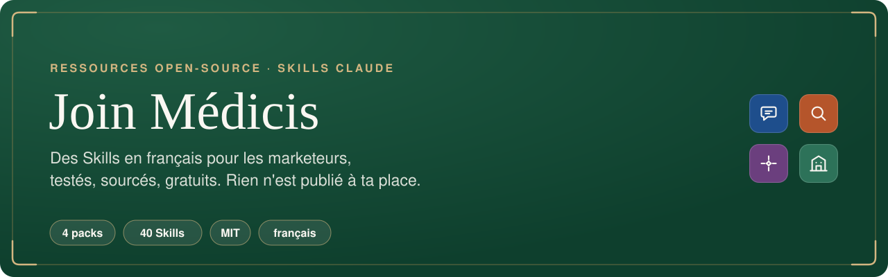

<div align="center">



<br>

**Des Skills en français pour les marketeurs et non-techniciens, compatibles avec Claude, ChatGPT, Gemini, Mistral et pleins d'autres IA !**<br>
Retrouve des skills autour de LinkedIn, du SEO/GEO et prochainement : Paids, UX/UI, etc...

<!-- github-seulement -->
[](#licence)
[](#les-packs)
[](#comment-ils-sont-construits)
[](#installer)
[](https://github.com/Aleksander-Siebert/join-medicis-ressources)

[**Les packs**](#les-packs) · [Installer](#installer) · [Comment ils sont construits](#comment-ils-sont-construits) · [joinmedicis.com](https://joinmedicis.com/ressources/skills)
<!-- /github-seulement -->

</div>

---

## Les packs

<table>
<tr>
<td width="72" align="center"></td>
<td><b><a href="linkedin-skills/">LinkedIn Skills</a></b> · 15 Skills · v2.1<br>De la stratégie au message privé : profil noté sur 100, posts sur 27 formules, humaniseur français, plan de la semaine, audit statistique de tes posts, prospection dans le cadre de la CNIL.<br><sub><a href="https://joinmedicis.com/ressources/skills/linkedin-skills">Fiche Join Médicis</a> · <a href="linkedin-skills/evals/RESULTATS.md">Résultats des évaluations</a></sub></td>
</tr>
<tr>
<td width="72" align="center"></td>
<td><b><a href="seo-skills/">SEO Skills</a></b> · 14 Skills · v2.0<br>Du mot-clé à l'article publié : plan validé avant la rédaction, couverture des requêtes mesurée, article en étapes avec portail qualité, affirmations sans source bloquées, audit (robots.txt, photo avant / après), maillage interne, mises à jour pilotées par Search Console, veille, SEO local et social.<br><sub><a href="https://joinmedicis.com/ressources/skills/seo-skills">Fiche Join Médicis</a> · <a href="seo-skills/evals/RESULTATS.md">Résultats des évaluations</a></sub></td>
</tr>
<tr>
<td width="72" align="center"></td>
<td><b><a href="geo-skills/">GEO Skills</a></b> · 8 Skills · v2.0<br>Être lu, compris et cité par ChatGPT, Perplexity, Gemini, Claude, Mistral et Google : audit couche par couche, visibilité avec sa marge d'erreur, robots d'IA, exactitude de ce que disent les IA, entité, sites tiers, agents.<br><sub><a href="https://joinmedicis.com/ressources/skills/geo-skills">Fiche Join Médicis</a> · <a href="geo-skills/evals/RESULTATS.md">Comparaison avec les Skills GEO publics</a></sub></td>
</tr>
<tr>
<td width="72" align="center"></td>
<td><b><a href="ads-skills/">ChatGPT Ads</a></b> · 1 Skill · v0.1<br>Préparer une campagne ChatGPT Ads : carte des intentions, ad groups, context hints écrits comme des situations, annonces dont chaque promesse a une source, fichier XLSX au format du modèle d'import. Rien n'est lancé à ta place.<br><sub><a href="ads-skills/evals/RESULTATS.md">Résultats des évaluations</a></sub></td>
</tr>
<tr>
<td width="72" align="center"></td>
<td><b><a href="fondation-skills/">Fondation</a></b> · 1 Skill sur 4 · v0.1, en construction<br>Le contexte de ton entreprise que toute IA lit avant d'écrire : chaque fait étiqueté, daté et sourcé, mentions légales et numéros contrôlés, rien d'enregistré sans ton accord.</td>
</tr>
</table>

Chaque pack marche seul. Aucun n'a besoin d'un autre pour fonctionner.

## Installer

### Claude Code

```
/plugin marketplace add Aleksander-Siebert/join-medicis-ressources
/plugin install linkedin-skills@join-medicis
/plugin install seo-skills@join-medicis
/plugin install geo-skills@join-medicis
/plugin install ads-skills@join-medicis
```

La Fondation rejoindra le marketplace quand ses quatre Skills seront prêts ;
d'ici là, copie `fondation-skills/skills/fondation-entreprise/` dans
`~/.claude/skills/`.

### claude.ai, ChatGPT, Gemini, Mistral

Chaque pack a sa fiche sur [joinmedicis.com](https://joinmedicis.com/ressources/skills)
avec un ZIP prêt à importer sur claude.ai, et son README explique comment
l'utiliser dans les autres IA.

## Comment ils sont construits

1. **Rétro-ingénierie complète.** Chaque pack part des meilleurs Skills
   open-source du sujet, lus fichier par fichier : Skills, références,
   scripts exécutés, tests, historique.
2. **Une matrice de capacités par Skill** : reprendre, améliorer ou écarter,
   avec la raison. Les matrices sont publiées dans [`recherche/`](recherche/).
3. **La mesure séparée du jugement.** Tout ce qui se mesure l'est par un
   script Python testé, sans dépendance ; Claude écrit et explique.
4. **Des faits datés.** Chaque affirmation sur une plateforme, la loi ou un
   registre public porte son niveau de preuve, sa source et sa date. Ce qui
   n'est pas vérifié porte « à vérifier ».
5. **Des évaluations à l'aveugle**, face aux références, publiées défaites
   comprises.

Les règles de travail sont dans [`CLAUDE.md`](CLAUDE.md). Les visuels des
README (bannières, icônes, captures des vraies sorties des scripts) sont
produits par [`outils/visuels/`](outils/visuels/).

## Les principes

- **Zéro invention** : aucun chiffre, prix, délai, source ou réponse d'IA
  inventé. Ce qui manque devient `{{à compléter}}`.
- **Rien n'est publié ni envoyé à ta place** : les Skills écrivent, comptent
  et vérifient ; tu publies.
- **Le français et le marché français** : typographie française, CNIL,
  registres publics, jours fériés, exemples anonymisés (l'entreprise fictive
  Assurly).

## Licence

MIT, sauf mention contraire dans un pack. Chaque pack crédite les projets
open-source dont il s'inspire dans son `CREDITS.md` et reproduit leurs
mentions de licence dans son `LICENSE`.

<div align="center">
<br>
<sub>Par <a href="https://joinmedicis.com">Join Médicis</a>, la bibliothèque IA gratuite des marketeurs francophones.</sub>
</div>
