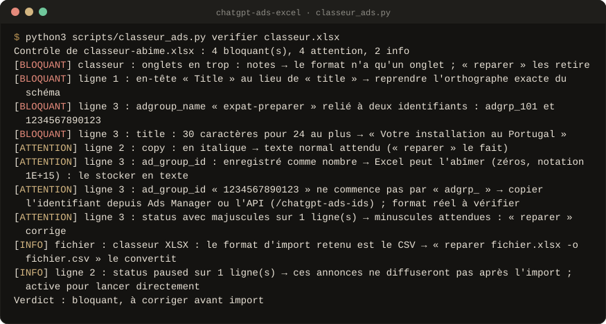

<div align="center">


<br>

**Des campagnes ChatGPT Ads ciblées par intention, écrites juste, prêtes à importer.**<br>
5 Skills spécialisés France : la campagne, la montée à 120 annonces sans doublons, la reprise d'exports Google, Meta et Microsoft Ads, les identifiants, le classeur d'import contrôlé par script. **Rien n'est lancé à ta place, rien n'est inventé.**

<!-- github-seulement -->
[](#versions)
[](#preuves)
[](LICENSE)
[](#le-script)
[](#claude-code)
[](#claudeai)
[](https://github.com/Aleksander-Siebert/join-medicis-ressources)

[**Installer**](#installer) · [Les Skills](#les-skills) · [En images](#en-images) · [Crédits](CREDITS.md)
<!-- /github-seulement -->

<!-- Emplacement du GIF de démonstration (voir docs/media/A-FILMER.md, prise 1).
     Quand il existe, remplace l'image ci-dessous par :
      -->


<sub>Sortie réelle du contrôle sur une campagne de test volontairement fautive : titre trop long, « n°1 » sans preuve, code pays faux, image manquante, noms qui ne correspondent pas.</sub>

</div>

> **Version 0.2.** Cinq Skills, spécialisés pour la France. ChatGPT Ads
> existe depuis le début de 2026 : le pack dit ce qui est documenté, ce qui
> est une hypothèse et ce qui reste à confirmer, avec la date.

---

## Pourquoi

Une annonce ChatGPT s'affiche sous une réponse, parce qu'elle colle à la
conversation. Pas de mot-clé à acheter : des **context hints** qui décrivent
les situations où l'annonce a sa place. Les erreurs coûtent cher et se
voient tard : des titres qui dépassent la limite, des hints vagues, des
promesses que la page ne tient pas, un import refusé pour une colonne mal
nommée ou un identifiant abîmé par Excel.

**Ce pack prépare la campagne, il ne la pilote pas.** Il part des
intentions des clients, écrit des hints comme des situations, rédige des
annonces dont chaque promesse a une source, contrôle tout ce qui se compte
et écrit le classeur d'import. Pour un secteur restreint par OpenAI
(finance, assurance, santé, juridique), il **alerte** avec la règle datée,
propose des pistes conformes, **puis fait le travail demandé**, avec des
annonces qui disent vraiment ce qu'elles vendent.

## Les Skills

<table>
<tr>
<td width="64" align="center"></td>
<td><b><code>/chatgpt-ads-skills</code></b><br>La campagne de départ : entretien d'une question à la fois, alerte et pistes si le secteur est restreint, allégations étayées, carte des intentions, 5 ad groups ou plus avec leurs context hints, 40 à 50 annonces (titre 24, copie 48), puis le classeur au schéma d'annonces et la fiche de paramétrage pour Ads Manager.</td>
<td width="150"><code>valider_exporter.py</code></td>
</tr>
<tr>
<td align="center"></td>
<td><b><code>/chatgpt-ads-bulk</code></b><br>De 40 à 50 annonces à 120 ou plus : analyse de leur construction (structures de titre, facettes d'intention, angles, mots répétés), lots de 50 au plus pour les groupes les moins garnis, chaque nouvelle annonce contrôlée contre toutes les autres, notes et listes Conserver, Corriger, Supprimer.</td>
<td><code>analyser_lot.py</code></td>
</tr>
<tr>
<td align="center"></td>
<td><b><code>/chatgpt-ads-exports</code></b><br>Lit en entier un export Google Ads, Meta Ads ou Microsoft Ads (annonces, termes de recherche), sort la banque de titres et de textes face aux limites, les allégations à vérifier avec leur ligne source, les pages, les meilleures annonces, les termes devenus situations, puis amorce la campagne à réécrire.</td>
<td><code>lire_exports.py</code></td>
</tr>
<tr>
<td align="center"></td>
<td><b><code>/chatgpt-ads-ids</code></b><br>Retrouve <code>ad_group_id</code>, <code>ad_id</code>, <code>image_file_id</code> et les événements de conversion : par l'API d'OpenAI en lecture seule (clé dans le terminal, jamais dans la conversation) ou depuis un export, puis les reporte dans le classeur en signalant les noms ambigus.</td>
<td><code>ids.py</code></td>
</tr>
<tr>
<td align="center"></td>
<td><b><code>/chatgpt-ads-excel</code></b><br>Contrôle et répare le classeur avant l'import : onglets, en-têtes, ordre, fusions, formules, italique, identifiants devenus des nombres, statuts, longueurs, liens et images (en ligne : taille et format carré), doublons. Ne raccourcit jamais un texte.</td>
<td><code>classeur_ads.py</code></td>
</tr>
</table>

## En images

Sorties réelles des scripts, sur les fichiers d'exemple du pack, régénérées à
chaque version (`outils/visuels/capture.py`).

<p align="center"><br>
<sub><b>Export</b> · l'exemple fictif Vélora (5 ad groups, 40 annonces) passe le contrôle ; le classeur suit le schéma d'annonces, la fiche liste ce qu'il faut créer dans Ads Manager et les identifiants à récupérer.</sub></p>

<p align="center"><br>
<sub><b>Contrôle du classeur</b> · un fichier abîmé comme on en voit souvent : onglet de notes en trop, « Title » au lieu de « title », italique, identifiant transformé en nombre, titre trop long.</sub></p>

## Installer

### Claude Code

```bash
/plugin marketplace add Aleksander-Siebert/join-medicis-ressources
/plugin install ads-skills@join-medicis
```

Ou copie les Skills dans tes Skills personnels :

```bash
git clone https://github.com/Aleksander-Siebert/join-medicis-ressources.git
cp -r join-medicis-ressources/ads-skills/skills/* ~/.claude/skills/
```

### claude.ai

Construis le ZIP avec `claude-ai/build.sh ads-skills.zip`, puis importe-le
dans Personnaliser → Skills : un seul Skill qui aiguille vers les 5
modules. Avec l'exécution de code activée, les scripts écrivent les
fichiers ; sans elle, le Skill livre les tableaux à coller et le dit.

### ChatGPT, Gemini, Mistral

Colle le contenu du `SKILL.md` voulu dans les instructions de ton Projet et
ajoute ses dossiers `references/` et `commun/` à ses connaissances. Les
contrôles par script demandent un environnement qui exécute Python.

## Les scripts

Python 3, sans dépendance, depuis le dossier de chaque Skill :

```bash
python3 scripts/valider_exporter.py exporter campagne.json -o import.xlsx    # /chatgpt-ads-skills
python3 scripts/analyser_lot.py analyser campagne.json --cible 120           # /chatgpt-ads-bulk
python3 scripts/lire_exports.py analyser annonces.csv termes.csv -o analyse.json   # /chatgpt-ads-exports
python3 scripts/ids.py lister -o ids.csv                                     # /chatgpt-ads-ids
python3 scripts/classeur_ads.py verifier import.xlsx --en-ligne              # /chatgpt-ads-excel
```

Le classeur d'import suit le **schéma d'annonces** : un onglet, 10
colonnes (`ad_id`, `ad_group_id`, `adgroup_name`, `ad_name`, `status`,
`title`, `copy`, `link`, `image_url`, `image_file_id`). Campagnes et ad
groups se créent dans Ads Manager, à partir de la fiche de paramétrage.
Codes de sortie communs : 0 prêt · 2 à revoir · 3 bloqué · 1 erreur d'usage.

## Ce qui tient le pack

<table>
<tr>
<td width="56" valign="top"></td>
<td><b>Chaque promesse a une source.</b> Un tableau des allégations (approuvée, à vérifier, refusée) avant toute rédaction ; une allégation vue dans un export reste à vérifier. Un chiffre, un prix, une garantie, un « gratuit » ou un superlatif absent de la liste bloque l'export.</td>
</tr>
<tr>
<td width="56" valign="top"></td>
<td><b>Le classeur d'import fait foi.</b> Format du schéma d'annonces contrôlé cellule par cellule ; ce qui n'est pas documenté (colonnes obligatoires, limites propres à ce format) est dit, et se confirme par un import d'essai de 2 ou 3 lignes.</td>
</tr>
<tr>
<td width="56" valign="top"></td>
<td><b>Des règles datées, pour la France.</b> Règles d'OpenAI v1.6 en entier (<a href="commun/politiques-openai.md"><code>commun/politiques-openai.md</code></a>), droit français utile aux annonces (<a href="commun/droit-francais.md"><code>commun/droit-francais.md</code></a>), faits sur la plateforme avec leur niveau de preuve (<a href="commun/faits.md"><code>commun/faits.md</code></a>).</td>
</tr>
</table>

## Preuves

```bash
python3 evals/tout_tester.py
```

**241 tests** : chaque script (contrôles, exports, lectures de fichiers
abîmés, API simulée en lecture seule, plan de lots, notes), l'intégrité du
pack, et 28 cas d'éval décrits dans [`evals/evals.json`](evals/evals.json).

**Éval à l'aveugle de la v0.1** (15 oct. 2026, 3 cas fictifs, un juge qui
ne savait pas qui était qui) :

| Cas | /chatgpt-ads-skills | chatgpt-ads-builder | Claude sans Skill |
|---|---|---|---|
| B2C, clics | **47**/60 | 46 | 45 |
| B2B, conversions | 44 | **46** | 42 |
| Assurance santé en France | **51** | 29 | 41 |

Depuis la v0.2, le cas « assurance santé en France » ne s'arrête plus : il
alerte, propose des pistes conformes, puis prépare la campagne. L'éval de
la v0.2 reste à faire sur des cas réels de l'utilisateur. Détail, sorties
et verdict : [`evals/RESULTATS.md`](evals/RESULTATS.md).

## Versions

Chaque version garde ce qui marche et ajoute ce que l'usage a demandé.

- **0.2.0** · 20 octobre 2026 · Cinq Skills, spécialisés France.
  - Nouveaux : `/chatgpt-ads-bulk` (120 annonces ou plus sans doublons),
    `/chatgpt-ads-exports` (exports Google, Meta, Microsoft Ads),
    `/chatgpt-ads-ids` (identifiants), `/chatgpt-ads-excel` (classeur).
  - Le classeur d'import suit le schéma d'annonces à 10 colonnes, avec une
    fiche de paramétrage pour Ads Manager.
  - Secteur restreint : alerte datée et pistes conformes, puis le travail
    demandé.
  - Règles d'OpenAI v1.6 en entier, droit français, faits France et Europe
    (pas de publicité personnalisée dans l'EEE, consentement du pixel).
- **0.1.0** · 15 octobre 2026 · Première version : le Skill
  `/chatgpt-ads-skills` et son script `valider_exporter.py`, l'éligibilité
  selon les règles d'OpenAI, la carte des intentions, un modèle d'import
  propre au pack, une éval à l'aveugle publiée.

## Crédits et licence

MIT. Les sources d'inspiration sont dans [CREDITS.md](CREDITS.md), les
mentions de licence dans [LICENSE](LICENSE). Les classeurs du pack sont
écrits par ses scripts ; seuls les noms d'onglets et de colonnes suivent
les formats d'OpenAI.

<div align="center">
<br>
<sub>Un pack <a href="https://joinmedicis.com">Join Médicis</a>, la bibliothèque IA gratuite des marketeurs francophones.</sub>
</div>
