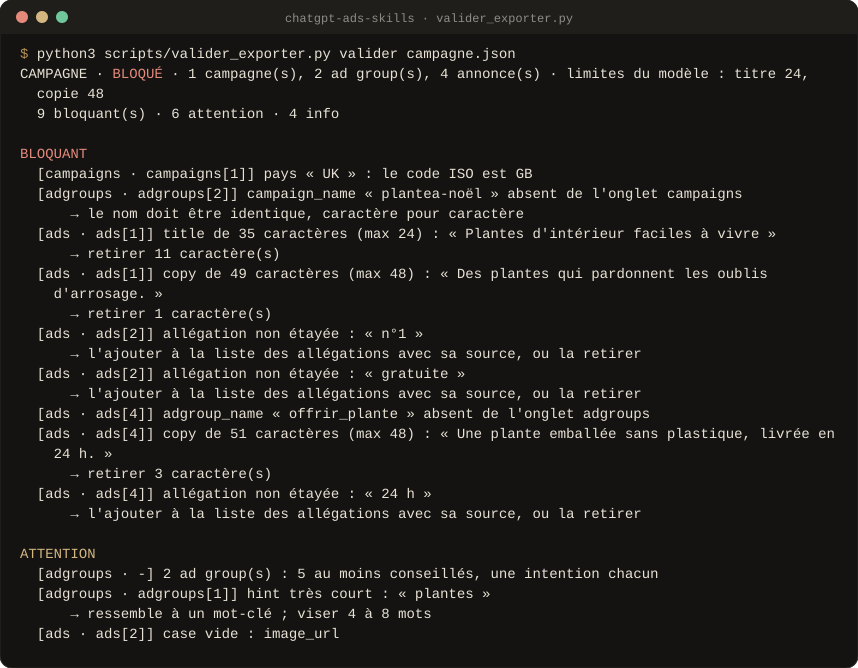
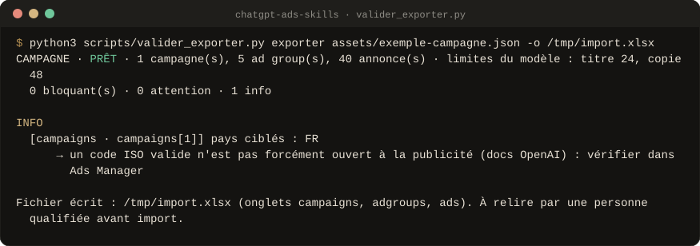
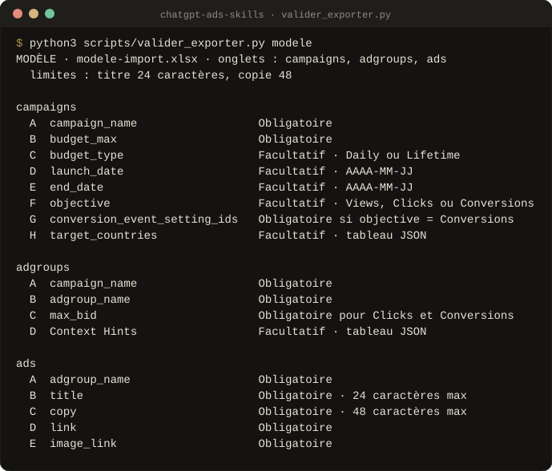

<div align="center">


<br>

**Des campagnes ChatGPT Ads ciblées par intention, écrites juste, prêtes à importer.**<br>
Carte des intentions, ad groups, context hints, annonces contrôlées par script et fichier XLSX au format du modèle d'OpenAI. **Rien n'est lancé à ta place, rien n'est inventé.**

<!-- github-seulement -->
[](#versions)
[](#preuves)
[](LICENSE)
[](#le-script)
[](#claude-code)
[](#claudeai)
[](https://github.com/Aleksander-Siebert/join-medicis-ressources)

[**Installer**](#installer) · [Le Skill](#le-skill) · [En images](#en-images) · [Crédits](CREDITS.md)
<!-- /github-seulement -->

<!-- Emplacement du GIF de démonstration (voir docs/media/A-FILMER.md, prise 1).
     Quand il existe, remplace l'image ci-dessous par :
      -->


<sub>Sortie réelle du contrôle sur une campagne de test volontairement fautive : titre trop long, « n°1 » sans preuve, code pays faux, image manquante, noms qui ne correspondent pas.</sub>

</div>

> **Version 0.1.** Un Skill, `/chatgpt-ads-skills`. ChatGPT Ads existe depuis
> le début de 2026 : le Skill dit ce qui est documenté, ce qui est une
> hypothèse et ce qui reste à confirmer.

---

## Pourquoi

Une annonce ChatGPT s'affiche sous une réponse, parce qu'elle colle à la
conversation. Pas de mot-clé à acheter : des **context hints** qui décrivent
les situations où l'annonce a sa place. Les erreurs coûtent cher et se
voient tard : des titres qui dépassent la limite du fichier d'import, des
hints vagues qui attirent des conversations hors sujet, des promesses que la
page ne tient pas, un fichier refusé à l'import.

**Ce pack prépare la campagne, il ne la pilote pas.** Il vérifie d'abord
que l'annonceur peut faire de la publicité dans ses pays (santé, finance et
juridique sont réservés aux États-Unis), puis part des intentions
des clients, écrit des hints comme des situations, rédige des annonces dont
chaque promesse a une source, puis contrôle tout ce qui se compte avant
d'écrire le fichier d'import.

## Le Skill

<table>
<tr>
<td width="64" align="center"></td>
<td><b><code>/chatgpt-ads-skills</code></b><br>Entretien d'une question à la fois (offre, marché, personas, moment du parcours, allégations autorisées, objectif et pays), liste des allégations étayées, carte des intentions, 5 ad groups ou plus avec 3 context hints chacun testés sur des prompts simulés, 40 à 50 annonces (100 en mode « grande échelle »), une idée de visuel par groupe, puis le fichier XLSX d'import et la checklist « Avant de dépenser ».</td>
<td width="150"><code>valider_exporter.py</code></td>
</tr>
</table>

## En images

Sorties réelles du script, sur les fichiers d'exemple du pack, régénérées à
chaque version (`outils/visuels/capture.py`).

<p align="center"><br>
<sub><b>Export</b> · l'exemple fictif Vélora (5 ad groups, 40 annonces) passe le contrôle ; le fichier garde les en-têtes du modèle, sans la ligne d'exemple, en texte normal.</sub></p>

<p align="center"><br>
<sub><b>Le modèle d'import du pack</b> · mêmes onglets et colonnes que celui d'Ads Manager, explications en français, contrôles de saisie ; les limites (titre 24, copie 48) sont lues dans le fichier, pas recopiées d'un guide.</sub></p>

## Installer

### Claude Code

```bash
/plugin marketplace add Aleksander-Siebert/join-medicis-ressources
/plugin install ads-skills@join-medicis
```

Ou copie le Skill dans tes Skills personnels :

```bash
git clone https://github.com/Aleksander-Siebert/join-medicis-ressources.git
cp -r join-medicis-ressources/ads-skills/skills/chatgpt-ads-skills ~/.claude/skills/
```

### claude.ai

Construis le ZIP avec `claude-ai/build.sh ads-skills.zip`, puis importe-le
dans Personnaliser → Skills. Avec l'exécution de code activée, le Skill écrit
le fichier XLSX ; sans elle, il livre les tableaux à coller et le dit.

### ChatGPT, Gemini, Mistral

Colle le contenu de `skills/chatgpt-ads-skills/SKILL.md` dans les
instructions de ton Projet et ajoute ses dossiers `references/` et `commun/`
à ses connaissances. Le contrôle par script demande un environnement qui
exécute Python.

## Le script

Python 3, sans dépendance, depuis le dossier du Skill :

```bash
python3 scripts/valider_exporter.py modele                       # relit le modèle d'import et ses limites
python3 scripts/valider_exporter.py valider campagne.json        # contrôle complet
python3 scripts/valider_exporter.py relecture campagne.json      # tableau de relecture humaine
python3 scripts/valider_exporter.py exporter campagne.json -o import.xlsx
python3 scripts/valider_exporter.py tableaux campagne.json       # repli : tableaux à coller
```

Ce qu'il contrôle : longueurs (lues dans le modèle), JSON des context hints,
noms identiques et uniques d'un onglet à l'autre, champs obligatoires,
doublons et reformulations minimes, URL et domaines, nombre d'annonces par
groupe, hints vagues, de marque ou géographiques, chevauchements entre
groupes, allégations absentes de la liste approuvée, éligibilité de la
catégorie selon les pays (règles publicitaires d'OpenAI), imitation de
ChatGPT, codes pays, dates, enchères. Codes de
sortie : 0 prêt · 2 à revoir · 3 bloqué · 1 erreur d'usage. Le fichier n'est
pas écrit tant qu'il reste un point bloquant.

## Ce qui tient le pack

<table>
<tr>
<td width="56" valign="top"></td>
<td><b>Chaque promesse a une source.</b> Un tableau des allégations (approuvée, à vérifier, refusée) avant toute rédaction. Un chiffre, un prix, une garantie, un « gratuit » ou un superlatif absent de la liste bloque l'export.</td>
</tr>
<tr>
<td width="56" valign="top"></td>
<td><b>Le fichier d'import fait foi.</b> Limites, colonnes et champs obligatoires lus dans le modèle (celui du pack, ou celui d'Ads Manager avec <code>--modele</code>) ; export au format exact : 3 onglets, en-têtes et contrôles conservés, ligne d'exemple retirée, texte normal.</td>
</tr>
<tr>
<td width="56" valign="top"></td>
<td><b>Des hypothèses dites comme telles.</b> Nombre de hints, longueur, volume d'annonces : les sources se contredisent. Chaque fait sur la plateforme porte son niveau de preuve et sa date (<a href="commun/faits.md"><code>commun/faits.md</code></a>), le reste est un choix par défaut à tester.</td>
</tr>
</table>

## Preuves

```bash
python3 evals/tout_tester.py
```

**142 tests** : le script (lecture du modèle, chaque règle de contrôle,
règles publicitaires, aller-retour de l'export, absence d'italique, modèle
d'Ads Manager comme modèle du pack) et l'intégrité du pack.

**Éval à l'aveugle** (15 oct. 2026, 3 cas fictifs, un juge qui ne savait
pas qui était qui) :

| Cas | /chatgpt-ads-skills | chatgpt-ads-builder | Claude sans Skill |
|---|---|---|---|
| B2C, clics | **47**/60 | 46 | 45 |
| B2B, conversions | 44 | **46** | 42 |
| Assurance santé en France | **51** | 29 | 41 |

Sur le cas sensible, le Skill est le seul à citer la règle exacte et à
s'arrêter. Sur le cas B2B, il perd : trop d'annonces pour le budget, des
groupes qui se recouvrent. Ces défauts sont corrigés et testés depuis.
Détail, sorties et verdict : [`evals/RESULTATS.md`](evals/RESULTATS.md).

## Versions

| Version | Date | Ce qui change |
|---|---|---|
| **0.1.0** | 15 oct. 2026 | Skill `/chatgpt-ads-skills`, script `valider_exporter.py`, exemple fictif complet. |

## Crédits et licence

MIT. Les sources d'inspiration sont dans [CREDITS.md](CREDITS.md), les
mentions de licence dans [LICENSE](LICENSE). Le modèle d'import
`modele-import.xlsx` est écrit par le pack (`outils/construire_modele.py`) ;
seuls ses noms d'onglets et de colonnes suivent le format d'OpenAI.

<div align="center">
<br>
<sub>Un pack <a href="https://joinmedicis.com">Join Médicis</a>, la bibliothèque IA gratuite des marketeurs francophones.</sub>
</div>
