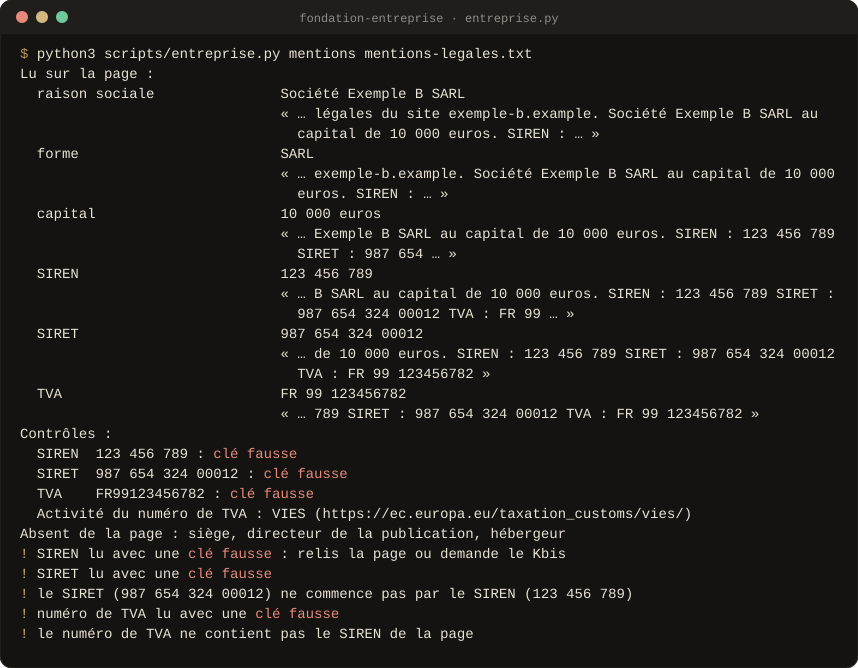
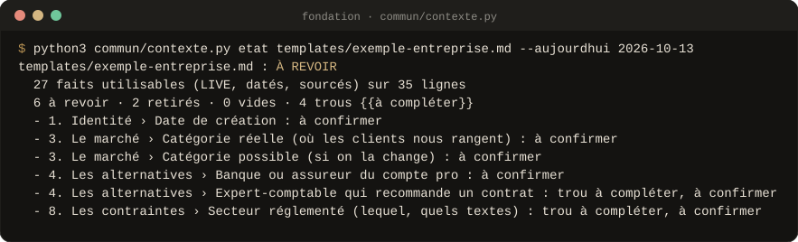
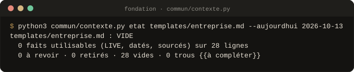

<div align="center">


<br>

**Le contexte de ton entreprise, écrit une fois, que toute IA lit avant d'écrire pour toi.**<br>
Chaque fait dit d'où il vient, à quelle date, et s'il est encore vrai. **Rien n'est inventé, rien n'est enregistré sans ton « oui ».**

<!-- github-seulement -->
[](#versions)
[](#preuves)
[](LICENSE)
[](#les-scripts)
[](#claude-code)
[](#claudeai)
[](#chatgpt-gemini-mistral)
[](https://github.com/Aleksander-Siebert/join-medicis-ressources)

[**Installer**](#installer) · [Les Skills](#les-skills) · [En images](#en-images) · [Crédits](CREDITS.md)
<!-- /github-seulement -->

<!-- Emplacement du GIF de démonstration (voir docs/media/A-FILMER.md, prise 1).
     Quand il existe, remplace l'image ci-dessous par :
      -->


<sub>Sortie réelle du contrôle des mentions légales sur un texte de test : chaque numéro vérifié, chaque incohérence signalée.</sub>

</div>

> **Version 0.1 : Skill modèle.** `/fondation-entreprise` est prêt.
> `/fondation-clients` et `/fondation-preuves` suivront sur le même gabarit.
> La voix a son propre pack : [`/tone-of-voice`](../tone-of-voice-skills).

---

## Pourquoi

Un contexte faux est pire qu'un contexte vide : tous les textes écrits
ensuite le répètent. Les modèles de « contexte de marque » qui circulent se
remplissent de déductions présentées comme des faits, de personas inventés et
de scores de complétude qui donnent 100 sur 100 à un modèle vide.

**La Fondation tient un contexte vérifiable.** Elle lit ton site avant de te
demander quoi que ce soit, sépare le fait lu de la déduction, contrôle ce qui
se contrôle (SIREN, SIRET, TVA, mentions légales) et montre tout avant
d'écrire. Chaque fait porte une étiquette, une date et une source.

## Les Skills

<table>
<tr>
<td width="64" align="center"></td>
<td><b><code>/fondation-entreprise</code></b><br>Lit ton site et tes mentions légales, puis te pose les questions qui manquent, une à la fois : offre, clients servis, alternatives dont le statu quo, différence prouvée, positionnement, objectifs du trimestre, ce qui coince, contraintes de secteur et de données (règles CNIL datées), outils. Mise à jour des faits périmés tous les 3 mois.</td>
<td width="150"><code>entreprise.py</code> <code>contexte.py</code></td>
</tr>
<tr>
<td width="64" align="center"><sub>à venir</sub></td>
<td><b><code>/fondation-clients</code></b> · clients idéaux déduits des vrais clients, personas étayés · <b><code>/fondation-preuves</code></b> · mots des clients, promesses vérifiées</td>
<td width="150"></td>
</tr>
</table>

Chaque Skill marche seul. Les packs SEO, GEO et LinkedIn marchent sans la
Fondation ; si tu les utilises, elle peut pré-remplir leurs fichiers de
contexte (`contexte.py exporter`), toujours sur ton accord.

## En images

Sorties réelles des scripts, sur les fichiers de test du pack, régénérées à
chaque version (`outils/visuels/capture.py`).

<p align="center"><br>
<sub><b>État du fichier</b> · seuls les faits datés, sourcés et vrais aujourd'hui comptent comme utilisables.</sub></p>

<p align="center"><br>
<sub><b>Le même contrôle sur le modèle vide</b> · VIDE, pas 100 sur 100.</sub></p>

## Installer

### Claude Code

Copie le Skill dans tes Skills personnels :

```bash
git clone https://github.com/Aleksander-Siebert/join-medicis-ressources.git
cp -r join-medicis-ressources/fondation-skills/skills/fondation-entreprise ~/.claude/skills/
```

Le pack rejoindra le marketplace `join-medicis` quand ses quatre Skills
seront prêts.

### claude.ai

Construis le ZIP avec `claude-ai/build.sh fondation-skills.zip`, puis
importe-le dans Personnaliser → Skills. Les fichiers de contexte vont dans
les connaissances de ton Projet.

### ChatGPT, Gemini, Mistral

Colle le contenu de `skills/fondation-entreprise/SKILL.md` dans les
instructions de ton Projet (GPT, Gem, agent) et mets `templates/entreprise.md`
dans ses connaissances.

## Les scripts

Python 3, sans dépendance :

```bash
python3 skills/fondation-entreprise/scripts/entreprise.py siren "123 456 782"
python3 skills/fondation-entreprise/scripts/entreprise.py mentions https://www.exemple.fr/mentions-legales
python3 commun/contexte.py etat ~/.claude/fondation/entreprise.md
python3 commun/contexte.py exporter --vers seo ~/.claude/fondation/entreprise.md
```

Codes de sortie : 0 rien à revoir · 2 à revoir · 3 bloqué ou vide · 1 erreur
d'usage. Un numéro bien formé n'est pas un numéro attribué : l'Annuaire des
entreprises et VIES le confirment.

## Ce qui tient le pack

<table>
<tr>
<td width="56" valign="top"></td>
<td><b>Des étiquettes sur chaque fait.</b> <code>LIVE</code> (vrai aujourd'hui, vérifiable), <code>À CONFIRMER</code> (déduit, ancien, incertain), <code>RETIRÉ</code> (n'est plus dit, ne revient jamais). Les mêmes que dans les packs LinkedIn, SEO et GEO.</td>
</tr>
<tr>
<td width="56" valign="top"></td>
<td><b>Les registres publics et les règles datées.</b> SIREN, SIRET et TVA contrôlés ; règles de prospection de la CNIL et fermeture de sirene.fr citées avec leur date (<a href="commun/faits.md"><code>commun/faits.md</code></a>). Pas d'avis juridique : des questions, et les sources.</td>
</tr>
<tr>
<td width="56" valign="top"></td>
<td><b>Rien sans ton « oui ».</b> Le fichier est montré en entier avant d'être écrit, une mise à jour montre « avant / après » ligne par ligne. Ces fichiers restent chez toi.</td>
</tr>
</table>

## Preuves

```bash
python3 evals/tout_tester.py
```

**57 tests** : les scripts, le socle commun et l'intégrité du pack. L'éval à
l'aveugle contre `product-marketing` (Corey Haines) suivra la relecture du
Skill modèle, et ses résultats seront publiés dans
[`evals/RESULTATS.md`](evals/RESULTATS.md), défaites comprises.

## Versions

Chaque version garde ce qui marche et ajoute ce que l'usage a demandé.

- **0.1.0** · 13 octobre 2026 · Première version : le socle commun et le
  Skill modèle `/fondation-entreprise`.
  - Un contexte d'entreprise vérifiable : chaque fait est étiqueté, daté et
    sourcé.
  - Les mentions légales et les registres publics français (SIREN, SIRET,
    TVA recoupés par script), avec les règles CNIL datées.
  - Un export facultatif vers les packs SEO et LinkedIn.

  Les autres Skills Fondation suivront sur ce modèle.

## Crédits et licence

MIT. Les sources d'inspiration sont dans [CREDITS.md](CREDITS.md), les
mentions de licence dans [LICENSE](LICENSE).

<div align="center">
<br>
<sub>Un pack <a href="https://joinmedicis.com">Join Médicis</a>, la bibliothèque IA gratuite des marketeurs francophones.</sub>
</div>
