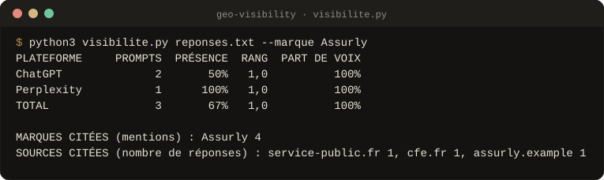
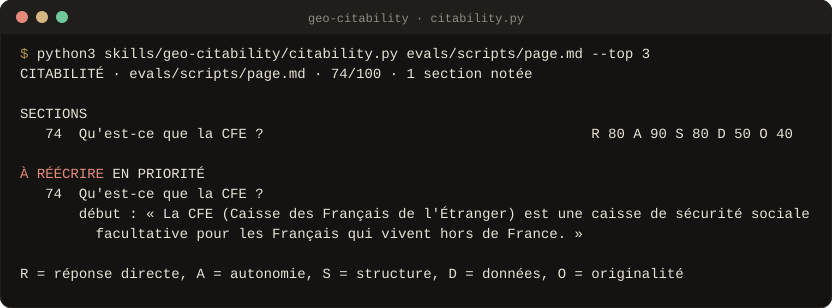

<div align="center">


<br>

**Huit Skills en français pour que votre marque soit citée par ChatGPT, Perplexity, Gemini, Claude, Mistral et les AI Overviews.**<br>
On dit aussi AEO : apparaître dans la réponse, pas seulement dans la liste de liens. **Aucun score, aucune réponse d'IA inventés.**

<!-- github-seulement -->
[](#versions)
[](#preuves)
[](LICENSE)
[](#les-scripts)
[](#claude-code)
[](#claudeai-et-claude-desktop)
[](#chatgpt-gemini-mistral)
[](https://github.com/Aleksander-Siebert/join-medicis-ressources)

[**Installer**](#installer) · [Les huit Skills](#les-huit-skills) · [En images](#en-images) · [Fiche Join Médicis](https://joinmedicis.com/ressources/skills/geo-skills) · [Crédits](CREDITS.md)
<!-- /github-seulement -->

<!-- Emplacement du GIF de démonstration (voir docs/media/A-FILMER.md, prise 1).
     Quand il existe, remplace l'image ci-dessous par :
      -->


<sub>Sortie réelle de la mesure de visibilité sur des réponses de test : présence, rang, part de voix et sources citées, par plateforme.</sub>

</div>

---

## Pourquoi

Le GEO attire les recettes miracles : fichiers « pour les IA », contenus
hachés en petits blocs, scores de visibilité sortis de nulle part. Le
[guide officiel de Google sur l'IA générative](https://developers.google.com/search/docs/fundamentals/ai-optimization-guide)
(juillet 2026) dit autre chose : pour AI Overviews et AI Mode, c'est d'abord
du SEO.

**Ce pack mesure ce qui se mesure et le dit.** Les scripts notent la
citabilité, l'accès des robots d'IA et les données structurées ; le reste est
évalué et affiché comme tel. Sans mesure, le Skill écrit « à évaluer ». Pas de
llms.txt présenté comme un levier, pas de réécriture « pour l'IA » : on écrit
mieux pour le lecteur.

## Les huit Skills

### Mesurer

<table>
<tr>
<td width="64" align="center"></td>
<td><b><code>/geo-audit</code></b><br>Score GEO sur 100 en six catégories. Chaque note dit si elle est mesurée ou évaluée.</td>
<td width="150"><code>geo_audit.py</code></td>
</tr>
<tr>
<td width="64" align="center"></td>
<td><b><code>/geo-visibilite</code></b><br>Questions en français, posées plusieurs fois : taux de mention, de lien et de recommandation avec leur marge d'erreur, moteur par moteur, questions perdues et sources citées.</td>
<td width="150"><code>visibilite.py</code></td>
</tr>
<tr>
<td width="64" align="center"></td>
<td><b><code>/geo-acces</code></b><br>Chaque robot d'IA lu pour ce qu'il fait (recherche, visite, entraînement) selon la RFC 9309, extrait autorisé, bloc Cloudflare, Content-Signal, pare-feu.</td>
<td width="150"><code>acces.py</code></td>
</tr>
<tr>
<td width="64" align="center"></td>
<td><b><code>/geo-exactitude</code></b><br>Ce que les IA disent de la marque, phrase par phrase, comparé à ses vraies données : faux, périmé, mauvaise devise, gravité, source à corriger.</td>
<td width="150"><code>exactitude.py</code></td>
</tr>
<tr>
<td width="64" align="center"></td>
<td><b><code>/geo-crawlers</code></b><br>Robots d'IA autorisés ou bloqués, un par un, robots.txt selon votre stratégie, brouillon de llms.txt.</td>
<td width="150"><code>crawlers.py</code></td>
</tr>
</table>

### Améliorer

<table>
<tr>
<td width="64" align="center"></td>
<td><b><code>/geo-contenu</code></b><br>Section par section : réponse en tête, passage qui se lit seul, statistiques sourcées, promesses à prouver, familles de faits que la question appelle. Avant et après, sans note sur 100.</td>
<td width="150"><code>contenu.py</code></td>
</tr>
<tr>
<td width="64" align="center"></td>
<td><b><code>/geo-citability</code></b><br>Note chaque section (réponse, autonomie, structure, données, originalité) et réécrit les passages faibles.</td>
<td width="150"><code>citability.py</code></td>
</tr>
<tr>
<td width="64" align="center"></td>
<td><b><code>/geo-entite</code></b><br>Un seul nom partout (title, og, H1, JSON-LD, ©), un bloc Organization propre, sameAs vérifiés, valeurs balisées visibles, candidats Wikidata, bloc à coller.</td>
<td width="150"><code>entite.py</code></td>
</tr>
<tr>
<td width="64" align="center"></td>
<td><b><code>/geo-schema</code></b><br>Ce qui manque en JSON-LD et le bloc à coller, rempli seulement avec des informations vraies.</td>
<td width="150"></td>
</tr>
<tr>
<td width="64" align="center"></td>
<td><b><code>/geo-agentic</code></b><br>Prépare les pages aux agents d'IA qui naviguent et remplissent des formulaires (boutons nommés, labels, page stable), et repère les consignes cachées aux IA.</td>
<td width="150"><code>agentic.py</code></td>
</tr>
</table>

### Rayonner

<table>
<tr>
<td width="64" align="center"></td>
<td><b><code>/geo-mentions</code></b><br>Les sites tiers cités là où la marque perd, page par page : marque présente ou absente, concurrents nommés, action légitime par classe de site.</td>
<td width="150"><code>sources.py</code></td>
</tr>
<tr>
<td width="64" align="center"></td>
<td><b><code>/geo-optimize</code></b><br>La stratégie : trois piliers, méthodes validées par la recherche, plan sur 90 jours.</td>
<td width="150"></td>
</tr>
</table>

Le pack partage `site-context.md` et `apprentissages.md` avec le
[pack SEO](../seo-skills). Les deux s'installent ensemble sans conflit.

## En images

Sorties réelles des scripts, sur les fichiers de test du pack, régénérées à
chaque version (`outils/visuels/capture.py`).

<p align="center"><br>
<sub><b>/geo-citability</b> · chaque section notée sur cinq critères, et le passage à réécrire en premier.</sub></p>

<!-- Emplacement d'un GIF (voir docs/media/A-FILMER.md, prise 2) :
      -->

## Installer

### Claude Code

```
/plugin marketplace add Aleksander-Siebert/join-medicis-ressources
/plugin install geo-skills@join-medicis
```

### claude.ai et Claude Desktop

1. Réglages → Capacités : activez l'exécution de code (pour les scripts).
2. Personnaliser → Skills → importez **`geo-skills.zip`**, téléchargé depuis
   [la fiche Join Médicis](https://joinmedicis.com/ressources/skills/geo-skills).
3. Mettez votre `site-context.md` dans les connaissances d'un Projet.

<details>
<summary>Construire le ZIP soi-même</summary>

`claude-ai/build.sh geo-skills.zip` construit le ZIP du pack. claude.ai
refuse un ZIP qui contient plusieurs `SKILL.md` ou le manifeste de plugin :
n'importez pas le dépôt tel quel.

</details>

### ChatGPT, Gemini, Mistral

Collez le `SKILL.md` voulu dans un Projet, un GPT, un Gem ou un agent. Les
Skills font alors les contrôles à la lecture, et le disent.

**Ensuite** : lancez `/geo-audit` sur votre page la plus importante.

## Les scripts

Python 3, sans dépendance :

```bash
python3 skills/geo-audit/geo_audit.py https://www.site.fr/guide/
python3 skills/geo-citability/citability.py https://www.site.fr/guide/ --top 5
python3 skills/geo-crawlers/crawlers.py https://www.site.fr --robots-propose equilibre
python3 skills/geo-agentic/agentic.py https://www.site.fr/devis/
python3 skills/geo-visibilite/scripts/visibilite.py mesurer reponses.txt --marque "Assurly" --concurrent "Concurrent A"
```

## Ce qui tient le pack

<table>
<tr>
<td width="56" valign="top"></td>
<td><b>Mesuré ou évalué, toujours dit.</b> Chaque note indique si elle vient d'un script ou d'un jugement. Un score partiel reste partiel ; une réponse d'IA n'est jamais imaginée, elle est collée par vous.</td>
</tr>
<tr>
<td width="56" valign="top"></td>
<td><b>Aligné sur les sources officielles.</b> Le guide de Google sur l'IA générative (juillet 2026) passe avant les recettes : pas de llms.txt vendu comme un levier, pas de contenus découpés pour les machines.</td>
</tr>
<tr>
<td width="56" valign="top"></td>
<td><b>Rien de publié à votre place.</b> Le Skill propose le robots.txt, le JSON-LD ou la réécriture ; vous les relisez et les mettez en ligne.</td>
</tr>
</table>

## Preuves

```bash
python3 evals/scripts/test_geo.py
```

**9 tests** sur les scripts et le README. Les évaluations comparatives sont dans
[`evals/RESULTATS.md`](evals/RESULTATS.md).

## Versions

Chaque version garde ce qui marche et ajoute ce que l'usage a demandé. La
version 2.0 est en développement.

- **1.1.0** · 2 octobre 2026 · Alignement sur le guide de Google consacré à
  l'IA générative, et un Skill de plus : `/geo-agentic`, pour des sites que
  les agents d'IA savent lire et utiliser.
- 1.0.0 · 2 octobre 2026 · Première version : 7 Skills AEO / GEO en
  français.
  - Un audit sur 100 dont le score reste partiel tant que tout n'est pas
    évalué, et la citabilité notée section par section.
  - Robots d'IA et llms.txt, et un test de visibilité à partir de réponses
    réelles collées.
  - Données structurées, mentions de marque et plan sur 90 jours.

## Crédits et licence

MIT. Les sources d'inspiration sont dans [CREDITS.md](CREDITS.md), les
mentions de licence dans [LICENSE](LICENSE).

<div align="center">
<br>
<sub>Un pack <a href="https://joinmedicis.com">Join Médicis</a>, la bibliothèque IA gratuite des marketeurs francophones.</sub>
</div>
