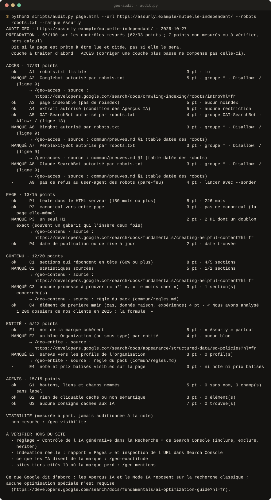
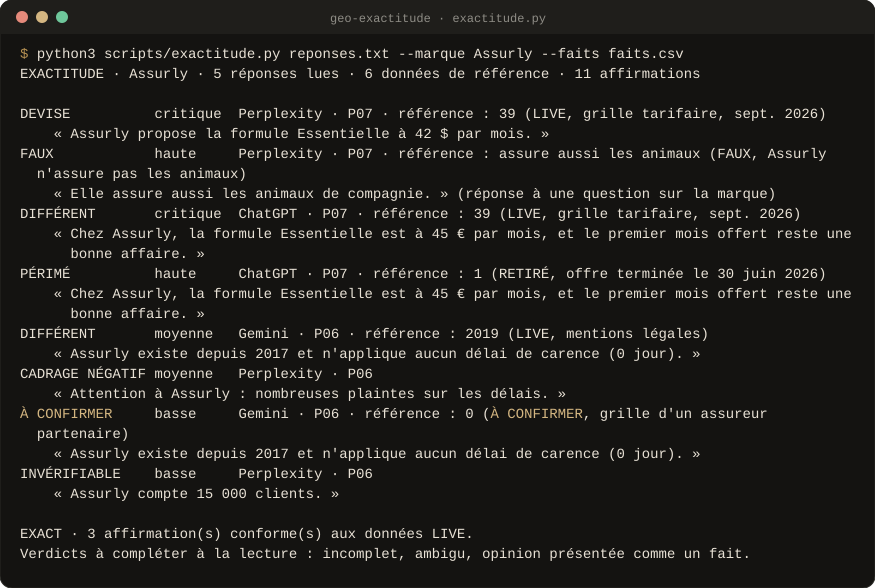
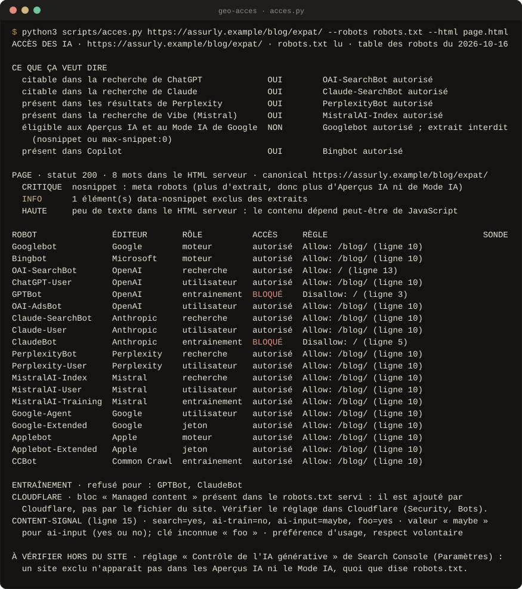

<div align="center">


<br>

**Huit Skills en français pour que votre marque soit lue, comprise et citée par ChatGPT, Perplexity, Gemini, Claude, Mistral et Google.**<br>
Des taux avec leur marge d'erreur, des contrôles avec leur preuve. **Aucune réponse d'IA inventée, aucune promesse de citation.**

<!-- github-seulement -->
[](#versions)
[](#preuves)
[](LICENSE)
[](#les-scripts)
[](#claude-code)
[](#claudeai-et-claude-desktop)
[](#chatgpt-gemini-mistral)
[](https://github.com/Aleksander-Siebert/join-medicis-ressources)

[**Installer**](#installer) · [Les huit Skills](#les-huit-skills) · [En images](#en-images) · [Comparaison](evals/RESULTATS.md) · [Fiche Join Médicis](https://joinmedicis.com/ressources/skills/geo-skills) · [Crédits](CREDITS.md)
<!-- /github-seulement -->



<sub>Sortie réelle de l'audit sur une page de test : chaque contrôle avec sa preuve et sa source, la couche à traiter d'abord, la visibilité à part.</sub>

</div>

---

## Pourquoi

Le GEO attire les recettes miracles : fichiers « pour les IA », contenus
hachés en blocs de 134 mots, scores de visibilité sortis de nulle part. Le
[guide de Google sur l'IA générative](https://developers.google.com/search/docs/fundamentals/ai-optimization-guide)
(juillet 2026) dit autre chose : pour les Aperçus IA et le Mode IA, c'est
d'abord du SEO. La recherche dit pareil : sur les moteurs actuels, réécrire
« pour l'IA » ne marche pas, et aucune technique GEO n'a d'effet causal
stable (C-SEO Bench, NeurIPS 2025 ; revue critique de 2026).

**Ce pack mesure ce qui se mesure, et le dit.**

- Une réponse d'IA est un tirage : on pose les vraies questions plusieurs
  fois et on rapporte des **taux avec leur marge d'erreur**, moteur par
  moteur.
- Chaque robot est lu pour ce qu'il fait : GPTBot entraîne, OAI-SearchBot
  cherche. Bloquer l'un n'est pas bloquer l'autre.
- Ce que les IA disent de faux sur la marque se relève phrase par phrase,
  et se corrige **à la source**.
- La note de préparation détaille ses 24 contrôles ; un contrôle non mesuré
  sort du calcul. La visibilité n'est jamais additionnée à la note.

## Les huit Skills

### Mesurer

<table>
<tr>
<td width="64" align="center"></td>
<td><b><code>/geo-audit</code></b><br>Diagnostic couche par couche (accès, page, contenu, entité, agents) : 24 contrôles avec preuve et source, couche à traiter d'abord, visibilité à part.</td>
<td width="150"><code>audit.py</code></td>
</tr>
<tr>
<td width="64" align="center"></td>
<td><b><code>/geo-visibilite</code></b><br>Questions françaises posées plusieurs fois : taux de mention, de citation, de recommandation et de mise en garde avec leur marge, moteur par moteur, part de voix, questions perdues, comparaison de deux périodes.</td>
<td width="150"><code>visibilite.py</code></td>
</tr>
<tr>
<td width="64" align="center"></td>
<td><b><code>/geo-acces</code></b><br>Chaque robot d'IA lu pour ce qu'il fait (recherche, visite, entraînement) selon la RFC 9309, extrait autorisé, bloc Cloudflare, Content-Signal, pare-feu, robots.txt par stratégie.</td>
<td width="150"><code>acces.py</code></td>
</tr>
<tr>
<td width="64" align="center"></td>
<td><b><code>/geo-exactitude</code></b><br>Ce que les IA disent de la marque, phrase par phrase, comparé à ses vraies données : faux, périmé, mauvaise devise, autre valeur, gravité, source à corriger.</td>
<td width="150"><code>exactitude.py</code></td>
</tr>
</table>

### Améliorer

<table>
<tr>
<td width="64" align="center"></td>
<td><b><code>/geo-contenu</code></b><br>Section par section : réponse en tête, passage qui se lit seul, statistiques sourcées, promesses à prouver, familles de faits que la question appelle. Avant et après, sans note sur 100.</td>
<td width="150"><code>contenu.py</code></td>
</tr>
<tr>
<td width="64" align="center"></td>
<td><b><code>/geo-entite</code></b><br>Un seul nom partout (title, og, H1, JSON-LD, ©), un bloc Organization propre, sameAs vérifiés, valeurs balisées visibles, candidats Wikidata, bloc à coller.</td>
<td width="150"><code>entite.py</code></td>
</tr>
<tr>
<td width="64" align="center"></td>
<td><b><code>/geo-agentic</code></b><br>Prépare les pages aux agents d'IA qui naviguent et remplissent des formulaires (boutons nommés, labels, page stable), et repère les consignes cachées aux IA.</td>
<td width="150"><code>agentic.py</code></td>
</tr>
</table>

### Rayonner

<table>
<tr>
<td width="64" align="center"></td>
<td><b><code>/geo-mentions</code></b><br>Les sites tiers cités là où la marque perd, page par page : marque présente ou absente, concurrents nommés, action légitime par classe de site.</td>
<td width="150"><code>sources.py</code></td>
</tr>
</table>

Le pack partage `site-context.md` et `apprentissages.md` avec le
[pack SEO](../seo-skills). Les deux s'installent ensemble sans conflit.

## En images

Sorties réelles des scripts, sur les fichiers de test du pack, régénérées à
chaque version (`outils/visuels/capture.py`).

<p align="center"><br>
<sub><b>/geo-visibilite</b> · des taux avec leur marge, moteur par moteur, et les questions perdues.</sub></p>

<p align="center"><br>
<sub><b>/geo-exactitude</b> · chaque affirmation sur la marque comparée à la donnée de référence.</sub></p>

<p align="center"><br>
<sub><b>/geo-acces</b> · le bon robot pour chaque affirmation, robots.txt lu selon la RFC 9309.</sub></p>

## Comparaison

Les huit Skills ont été confrontés aux Skills GEO publics que nous avons
étudiés, sur des cas dont la bonne réponse est connue d'avance : chaque
outil passe les mêmes cas, et le tableau dit, cas par cas, qui répond
juste, qui se trompe et ce qu'il a affiché. Défaites comprises :
[`evals/RESULTATS.md`](evals/RESULTATS.md).

## Installer

### Claude Code

```
/plugin marketplace add Aleksander-Siebert/join-medicis-ressources
/plugin install geo-skills@join-medicis
```

### claude.ai et Claude Desktop

1. Réglages → Capacités : activez l'exécution de code (pour les scripts).
2. Personnaliser → Skills → importez **`geo-skills.zip`**, téléchargé depuis
   [la fiche Join Médicis](https://joinmedicis.com/ressources/skills/geo-skills).
3. Mettez votre `site-context.md` dans les connaissances d'un Projet.

<details>
<summary>Construire le ZIP soi-même</summary>

`claude-ai/build.sh geo-skills.zip` construit le ZIP du pack. claude.ai
refuse un ZIP qui contient plusieurs `SKILL.md` ou le manifeste de plugin :
n'importez pas le dépôt tel quel.

</details>

### ChatGPT, Gemini, Mistral

Importez le ZIP dans les compétences de Gemini ou de ChatGPT, ou collez le
`SKILL.md` voulu dans Mistral. Sans exécution de code, les Skills font les
contrôles à la lecture, et le disent.

**Ensuite** : lancez `/geo-audit` sur votre page la plus importante, puis
`/geo-visibilite` sur vos dix questions clés.

## Les scripts

Python 3, sans dépendance. Chaque script a un mode hors ligne sur fichiers.

```bash
python3 skills/geo-audit/scripts/audit.py https://www.site.fr/page/ --marque "Assurly" --sonder
python3 skills/geo-visibilite/scripts/visibilite.py mesurer reponses.txt --marque "Assurly" --concurrent "Concurrent A"
python3 skills/geo-acces/scripts/acces.py https://www.site.fr/page/ --sonder --proposer equilibre
python3 skills/geo-exactitude/scripts/exactitude.py reponses.txt --marque "Assurly" --contexte site-context.md
python3 skills/geo-contenu/scripts/contenu.py https://www.site.fr/guide/ --question "Combien coûte… ?"
python3 skills/geo-entite/scripts/entite.py https://www.site.fr/ --marque "Assurly" --bloc
python3 skills/geo-mentions/scripts/sources.py mesure.json --reponses reponses.txt --marque "Assurly" --verifier
python3 skills/geo-agentic/scripts/agentic.py https://www.site.fr/devis/
```

## Ce qui tient le pack

<table>
<tr>
<td width="56" valign="top"></td>
<td><b>Des taux, des preuves, pas des notes magiques.</b> Une visibilité se donne avec sa marge et son nombre de passages ; un contrôle avec la ligne lue ; un contrôle non mesuré sort du calcul. Une réponse d'IA n'est jamais imaginée.</td>
</tr>
<tr>
<td width="56" valign="top"></td>
<td><b>Des sources primaires et datées.</b> Pages des robots d'OpenAI, Anthropic, Perplexity, Mistral, Google et Apple, guide de Google sur l'IA générative, Code de la consommation : chaque fait a sa date, le reste porte [à vérifier].</td>
</tr>
<tr>
<td width="56" valign="top"></td>
<td><b>Rien de publié à votre place.</b> Le Skill propose le robots.txt, le JSON-LD, la réécriture ou le message au comparateur ; vous les relisez et les mettez en ligne.</td>
</tr>
</table>

## Preuves

```bash
python3 evals/tout_tester.py
```

**191 tests** : un jeu par script, sur des fichiers fictifs (Assurly), et
des tests d'intégrité (aucun Skill n'affirme que GPTBot sert à la recherche
de ChatGPT, aucune donnée réelle, typographie). La comparaison avec les
Skills GEO publics est dans [`evals/RESULTATS.md`](evals/RESULTATS.md).

## Versions

- **2.0.0** · 16 octobre 2026 · Refonte complète après l'étude de douze
  dépôts GEO publics, fichier par fichier.
  - Huit Skills, dont trois nouveaux : `/geo-acces` (robots lus selon leur
    rôle), `/geo-exactitude` (ce que les IA disent de faux) et
    `/geo-entite` (une seule entité, un JSON-LD vrai).
  - `/geo-visibilite` mesure des taux avec leur marge et compare deux
    périodes sans confondre bruit et tendance.
  - Plus de score GEO composite : une note de préparation détaillée, la
    visibilité à part.
  - Remplacés : `/geo-crawlers` (par `/geo-acces`), `/geo-citability` (par
    `/geo-contenu`), `/geo-schema` (par `/geo-entite`), `/geo-optimize`
    (dans `/geo-audit`).
- 1.1.0 · 2 octobre 2026 · Alignement sur le guide de Google consacré à
  l'IA générative, et `/geo-agentic`.
- 1.0.0 · 2 octobre 2026 · Première version : 7 Skills AEO / GEO en
  français.

## Crédits et licence

MIT. Les sources d'inspiration sont dans [CREDITS.md](CREDITS.md), les
mentions de licence dans [LICENSE](LICENSE).

<div align="center">
<br>
<sub>Un pack <a href="https://joinmedicis.com">Join Médicis</a>, la bibliothèque IA gratuite des marketeurs francophones.</sub>
</div>
