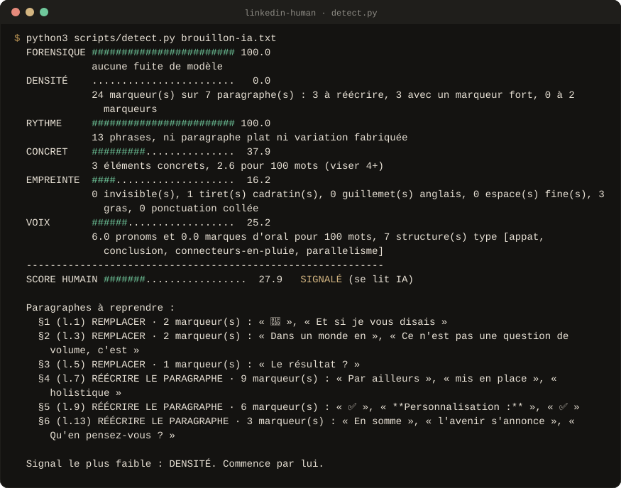
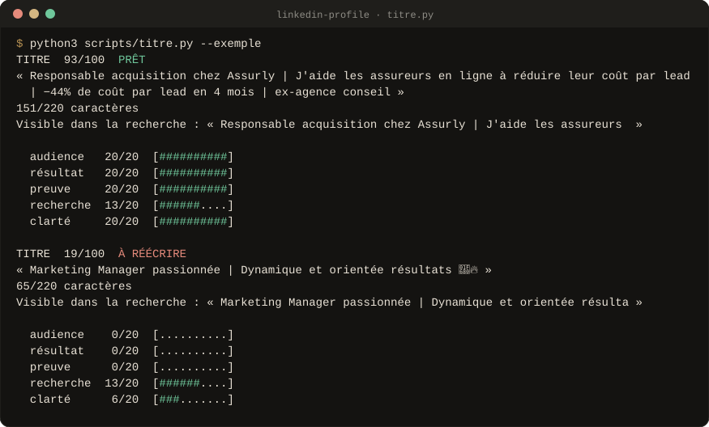
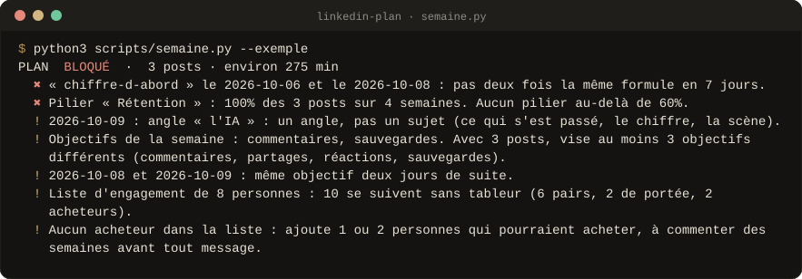
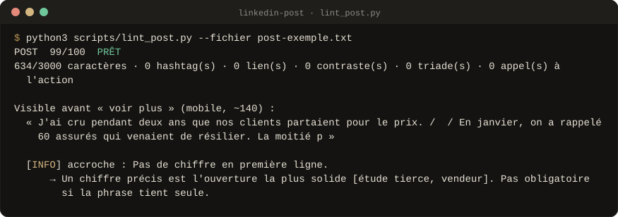
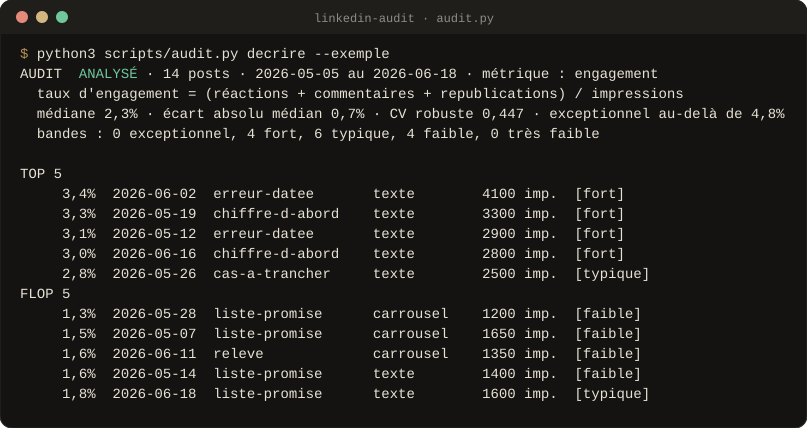

<div align="center">


<br>

**Quinze Skills Claude en français pour LinkedIn, de la stratégie au message privé.**<br>
Gratuits, sans inscription, sans clé d'API. Ils écrivent, comptent et vérifient. **Tu publies.**

<!-- github-seulement -->
[](#versions)
[](#preuves)
[](LICENSE)
[](#ce-qui-tient-le-pack)
[](#claude-code)
[](#claudeai-et-claude-desktop)
[](#chatgpt-gemini-mistral)
[](https://github.com/Aleksander-Siebert/join-medicis-ressources)

[**Installer**](#installer) · [Les quinze Skills](#les-quinze-skills) · [En images](#en-images) · [Fiche Join Médicis](https://joinmedicis.com/ressources/skills/linkedin-skills) · [Résultats des évaluations](evals/RESULTATS.md)
<!-- /github-seulement -->

<!-- Emplacement du GIF de démonstration (voir docs/media/A-FILMER.md, prise 1).
     Quand il existe, remplace l'image ci-dessous par :
      -->


<sub>Sortie réelle de l'humaniseur sur un brouillon de test du pack : chaque paragraphe à reprendre, et pourquoi.</sub>

</div>

---

## Pourquoi

Sur LinkedIn, un post écrit par une IA se reconnaît en trois lignes. Les
conseils sur l'algorithme se contredisent, et les outils poussent à
automatiser exactement ce que LinkedIn sanctionne. Les Skills open-source
existants sont en anglais, cassent la typographie française et laissent
l'IA inventer des chiffres.

**Ce pack est la version française, vérifiable et honnête.** Chaque Skill
part de ton contexte et de tes vraies preuves, sépare ce qui se mesure (des
scripts Python testés) de ce qui relève du jugement, cite ses sources avec
leur date, et ne publie jamais rien à ta place. Ce qui manque devient
`{{à compléter}}`, jamais un chiffre inventé.

## Les quinze Skills

### Le cap

<table>
<tr>
<td width="64" align="center"></td>
<td><b><code>/linkedin-strategie</code></b><br>Le cap à 90 jours : objectif vérifiable, cible avec exclusions, positionnement, 2 à 4 piliers, budget en minutes mesuré sur une mauvaise semaine, newsletter ou pas.</td>
<td width="150"><code>brief.py</code> <code>budget.py</code></td>
</tr>
<tr>
<td width="64" align="center"></td>
<td><b><code>/linkedin-interview</code></b><br>T'interviewe une question à la fois pour sortir tes chiffres, tes histoires et tes avis, et remplit ta réserve de preuves.</td>
<td width="150"><code>reserve.py</code></td>
</tr>
<tr>
<td width="64" align="center"></td>
<td><b><code>/linkedin-plan</code></b><br>La semaine : un angle par créneau, formules jamais répétées en 7 jours, piliers sous 60%, jours fériés français, heures tirées des études de 2026 puis de ton propre compte.</td>
<td width="150"><code>semaine.py</code></td>
</tr>
</table>

### Le profil

<table>
<tr>
<td width="64" align="center"></td>
<td><b><code>/linkedin-profile</code></b><br>Note ton profil sur 100 (les sections non vues ne sont pas notées), classe les corrections par points gagnés par heure, réécrit titre, Infos et expériences chiffrées.</td>
<td width="150"><code>audit_profil.py</code> <code>titre.py</code> <code>infos.py</code></td>
</tr>
<tr>
<td width="64" align="center"></td>
<td><b><code>/linkedin-entreprise</code></b><br>La page entreprise (grille sourcée) et le programme d'ambassadeurs : cadence, niveaux de relecture, charte.</td>
<td width="150"><code>audit_page.py</code> <code>ambassadeurs.py</code></td>
</tr>
<tr>
<td width="64" align="center"></td>
<td><b><code>/linkedin-job</code></b><br>Recherches booléennes, offres publiées dans la dernière heure, profil calé sur les offres visées, suivi des candidatures et relances.</td>
<td width="150"><code>job_url.py</code> <code>candidatures.py</code></td>
</tr>
</table>

### Écrire

<table>
<tr>
<td width="64" align="center"></td>
<td><b><code>/linkedin-post</code></b><br>Une idée devient un post : 27 formules d'accroche choisies par objectif, règle de densité des tics, contrôle avant publication.</td>
<td width="150"><code>lint_post.py</code> <code>format.py</code></td>
</tr>
<tr>
<td width="64" align="center"></td>
<td><b><code>/linkedin-carrousel</code></b><br>Le texte de chaque diapo, le PDF à téléverser et la bannière en PNG.</td>
<td width="150"><code>carrousel.py</code></td>
</tr>
<tr>
<td width="64" align="center"></td>
<td><b><code>/linkedin-human</code></b><br>L'humaniseur français : corrige la typographie et les tics d'IA, signale ce qui demande une réécriture, vérifie qu'aucun fait n'a été ajouté ni perdu.</td>
<td width="150"><code>humanize.py</code> <code>detect.py</code> <code>fidelite.py</code></td>
</tr>
<tr>
<td width="64" align="center"></td>
<td><b><code>/linkedin-repurpose</code></b><br>Une vidéo, un article ou un fil devient des posts qui tiennent seuls, sans republier trois fois la même idée.</td>
<td width="150"><code>registre.py</code></td>
</tr>
</table>

### Échanger

<table>
<tr>
<td width="64" align="center"></td>
<td><b><code>/linkedin-comment</code></b><br>Quels posts commenter (grille), quel type de commentaire, contrôle « un angle que le post n'a pas ».</td>
<td width="150"><code>commentaire.py</code></td>
</tr>
<tr>
<td width="64" align="center"></td>
<td><b><code>/linkedin-reply</code></b><br>Le fil sous tes posts : filtre chiffré, prospects notés sur 10, 5 modèles de réponse.</td>
<td width="150"><code>fil.py</code></td>
</tr>
<tr>
<td width="64" align="center"></td>
<td><b><code>/linkedin-dm</code></b><br>Note d'invitation, premier message, une relance qui apporte du nouveau, volume de la semaine, dans le cadre de la CNIL.</td>
<td width="150"><code>message.py</code> <code>volume.py</code></td>
</tr>
<tr>
<td width="64" align="center"></td>
<td><b><code>/linkedin-inbox</code></b><br>Tri de la messagerie, séquences automatisées démasquées, prospects prêts pour le CRM.</td>
<td width="150"><code>boite.py</code></td>
</tr>
</table>

### Mesurer

<table>
<tr>
<td width="64" align="center"></td>
<td><b><code>/linkedin-audit</code></b><br>Ce qui marche vraiment sur ton compte : médiane, motifs testés par permutation (format, formule, jour, heure), motifs confondus, expériences chiffrées. Lit l'export .xlsx de LinkedIn.</td>
<td width="150"><code>audit.py</code></td>
</tr>
</table>

Tous les scripts sont en Python, sans dépendance. Ils marchent hors ligne et
ne touchent jamais à LinkedIn.

## En images

Sorties réelles des scripts, sur les fichiers de test du pack. Elles sont
régénérées à chaque version (`outils/visuels/capture.py`) : si un script
change, l'image change avec lui.

<p align="center"><br>
<sub><b>/linkedin-profile</b> · deux titres de profil notés sur 100, critère par critère.</sub></p>

<p align="center"><br>
<sub><b>/linkedin-plan</b> · un plan bloqué avant d'être publié, avec la raison.</sub></p>

<details>
<summary><b>Deux autres captures</b> : le contrôle d'un post, l'audit de tes statistiques</summary>
<br>
<p align="center"><br>
<sub><b>/linkedin-post</b> · le contrôle avant publication, et ce qu'on lit avant « voir plus ».</sub></p>

<p align="center"><br>
<sub><b>/linkedin-audit</b> · tes posts comparés à ta propre médiane, pas à un benchmark.</sub></p>
</details>

<!-- Emplacements des GIF (voir docs/media/A-FILMER.md, prises 2 et 3) :
     
      -->

## Installer

### Claude Code

```
/plugin marketplace add Aleksander-Siebert/join-medicis-ressources
/plugin install linkedin-skills@join-medicis
```

<details>
<summary>Ou à la main, sans le système de plugins</summary>

```bash
git clone https://github.com/Aleksander-Siebert/join-medicis-ressources.git
cp -r join-medicis-ressources/linkedin-skills/skills/linkedin-* ~/.claude/skills/
mkdir -p ~/.claude/linkedin
cp join-medicis-ressources/linkedin-skills/templates/*.md ~/.claude/linkedin/
```

Pour un seul projet, copie les dossiers dans `.claude/skills/` du dépôt.
Chaque dossier de Skill contient sa copie du socle commun (`commun/`) : il
marche seul.

</details>

### claude.ai et Claude Desktop

1. Réglages → Capacités : active l'exécution de code (pour les scripts).
2. Personnaliser → Skills → importe **`linkedin-skills.zip`**, téléchargé
   depuis [la fiche Join Médicis](https://joinmedicis.com/ressources/skills/linkedin-skills).
   Un seul `SKILL.md` aiguille vers les 15 modules.
3. Mets tes fichiers (`contexte.md`, `reserve.md`), remplis, dans les
   connaissances d'un Projet.

<details>
<summary>Construire le ZIP soi-même, ou importer un Skill à la fois</summary>

`claude-ai/build.sh linkedin-skills.zip` construit le ZIP du pack. Pour un
seul Skill, zippe un dossier `skills/linkedin-*`. claude.ai refuse un ZIP qui
contient plusieurs `SKILL.md` ou le manifeste de plugin `.claude-plugin/` :
n'importe pas le dépôt tel quel.

</details>

### ChatGPT, Gemini, Mistral

Colle le `SKILL.md` voulu dans les instructions d'un Projet, d'un GPT, d'un
Gem ou d'un agent, avec `commun/regles.md` et tes fichiers. Sans exécution de
code, chaque Skill applique ses grilles écrites et dit que le contrôle
automatique n'a pas tourné.

## Démarrer en vingt minutes

1. **`/linkedin-strategie`** : le cap, et `contexte.md` rempli.
2. **`/linkedin-interview`** : tes chiffres et tes histoires dans `reserve.md`.
3. **`/linkedin-plan`**, puis « écris mardi » : le premier post.

Sans les deux premiers fichiers, tout sort avec la voix et les exemples de
tout le monde.

## Tes fichiers

Dans `~/.claude/linkedin/` (ou les connaissances d'un Projet). Modèles vides
dans [`templates/`](templates/).

| Fichier | Ce qu'il contient | Écrit par |
|---|---|---|
| `contexte.md` | qui tu es, ta voix, ton objectif, tes piliers, tes offres ; chaque fait marqué LIVE, À CONFIRMER ou RETIRÉ | `/linkedin-strategie`, toi |
| `reserve.md` | tes preuves : chiffres, histoires, avis, erreurs | `/linkedin-interview`, toi |
| `journal.md` | posts publiés (avec l'heure réelle), idées déjà utilisées, commentaires, contacts, candidatures | les Skills, sur ton « ok » |
| `apprentissages.md` | ce qui marche pour **ton** compte, les expériences en cours | `/linkedin-audit` et les autres, après ta validation |

Rien ne s'écrit sans toi. Ces fichiers restent chez toi : ne les mets pas
dans un dépôt public.

## Ce qui tient le pack

<table>
<tr>
<td width="56" valign="top"></td>
<td><b>Un garde-fou et des preuves datées.</b> Le socle commun refuse l'automatisation, l'extraction de données, les pods et les messages en masse, et encadre la prospection (cadre CNIL). Chaque affirmation sur LinkedIn est classée officielle, étude tierce, praticien ou folklore, avec sa source et sa date (<a href="commun/preuves.md"><code>commun/preuves.md</code></a>).</td>
</tr>
<tr>
<td width="56" valign="top"></td>
<td><b>La mesure séparée du jugement.</b> Les scripts comptent, notent et bloquent ; Claude écrit et explique. Aucun score ne récompense un texte vide ni un chiffre inventé.</td>
</tr>
<tr>
<td width="56" valign="top"></td>
<td><b>Une sortie normée.</b> Chaque Skill rend un format fixe, comparable d'une semaine à l'autre, et propose un seul Skill pour la suite.</td>
</tr>
</table>

## Preuves

```bash
python3 evals/tout_tester.py
```

**249 tests** : chaque script, les suites autonomes de l'humaniseur et les
tests d'intégrité du pack (frontmatter, fichiers cités, socle synchronisé,
grilles sur 100, modèles vides). L'évaluation à l'aveugle de la v2 a gagné
**8 tâches sur 10** face aux meilleures références. Les défaites et ce qui a
été corrigé sont publiés dans [`evals/RESULTATS.md`](evals/RESULTATS.md),
y compris un retour d'usage réel sur les horaires de publication.

L'humaniseur repose sur des heuristiques locales, pas sur un détecteur
commercial : personne ne peut vendre honnêtement de l'« indétectable ».

## Versions

Chaque version garde ce qui marche et ajoute ce que l'usage a demandé.

- **2.1.0** · 14 octobre 2026 · Des horaires de publication plus précis,
  après un usage réel :
  - créneaux tirés des études de 2026 (Sprout Social, Buffer) ;
  - heure réelle de publication notée dans `journal.md` ;
  - créneau horaire testé par `/linkedin-audit`.
- 2.0.0 · 2 octobre 2026 · Une refonte en 15 Skills sur un socle commun
  (règles, preuves datées, garde-fou).
  - L'humaniseur gagne 4 passes, 3 niveaux, une lecture paragraphe par
    paragraphe et un contrôle de fidélité des faits.
  - `/linkedin-interview`, `/linkedin-strategie` et `/linkedin-entreprise`
    rejoignent le pack.
  - `/linkedin-audit` passe à la statistique (médiane, motifs testés) ;
    `/linkedin-plan` suit le calendrier français ; `/linkedin-carrousel`
    produit le PDF.
  - Une éval à l'aveugle est publiée : 8 tâches gagnées sur 10 face aux
    meilleures références de chaque sujet.
- 1.0.0 · 1er octobre 2026 · Première version : 12 Skills LinkedIn en
  français, avec un humaniseur français et la recherche d'offres d'emploi
  de la dernière heure. Commandes `/linkedin-*` et ZIP pour claude.ai.

## Crédits et licence

MIT : prends-le, modifie-le, partage-le. Le pack est construit à partir des
meilleurs Skills LinkedIn open-source, lus fichier par fichier puis réécrits
pour le français : la liste est dans [CREDITS.md](CREDITS.md), les mentions
de licence dans [LICENSE](LICENSE).

<div align="center">
<br>
<sub>Un pack <a href="https://joinmedicis.com">Join Médicis</a>, la bibliothèque IA gratuite des marketeurs francophones.</sub>
</div>
