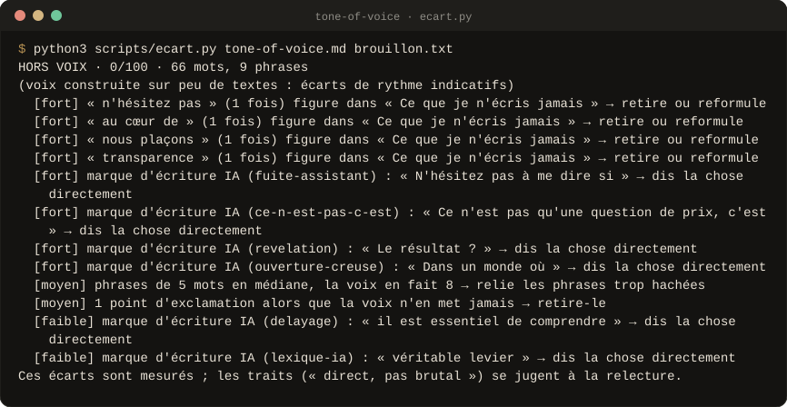
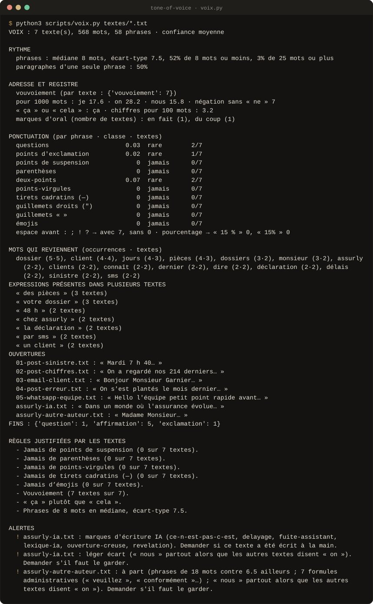

<div align="center">

# Tone of Voice, par Join Médicis

**Ta voix d'écriture, trouvée dans tes vrais textes, que toute IA respecte ensuite.**<br>
Des mesures chiffrées, quelques questions, trois variantes à choisir. **Rien n'est inventé, rien n'est enregistré sans ton « oui ».**

<!-- github-seulement -->
[](#versions)
[](#preuves)
[](LICENSE)
[](#les-scripts)
[](#claude-code)
[](#claudeai)

[**Installer**](#installer) · [Ce que fait le Skill](#ce-que-fait-le-skill) · [En images](#en-images) · [Le fichier](#le-fichier-tone-of-voicemd) · [Crédits](CREDITS.md)
<!-- /github-seulement -->



<sub>Sortie réelle : un post générique comparé à la voix de Camille (entreprise fictive). Chaque écart est mesuré, rien n'est deviné.</sub>

</div>

---

## Pourquoi

Demande à une IA d'écrire « comme toi » : elle écrit comme tout le monde.
Les guides de ton de voix qui circulent ne l'aident pas, ils disent
« professionnel mais accessible », ce qui décrit n'importe qui.

**`/tone-of-voice` part de ce que tu écris vraiment.** Un script mesure tes
textes (longueur des phrases, ponctuation que tu n'emploies jamais, tu ou
vous, « ça » ou « cela »), le Skill compare avec ce qu'une IA aurait écrit à
ta place, te pose seulement les questions que tes textes ne résolvent pas,
puis te fait choisir entre trois versions d'un même message. Tu ne décris pas
ta voix : tu la reconnais.

## Ce que fait le Skill

<table>
<tr>
<td width="64" align="center"></td>
<td><b><code>/tone-of-voice</code></b><br>Trouve ta voix dans tes textes (ou à partir d'un style qui t'inspire, ou de quelques questions), l'écrit dans un fichier que toute IA respecte, réécrit et vérifie tes textes, et se met à jour quand tu le corriges.</td>
<td width="150"><code>voix.py</code> <code>ecart.py</code> <code>profil.py</code></td>
</tr>
</table>

| Mode | Tu dis | Tu obtiens |
|---|---|---|
| **Créer** | « Crée mon tone of voice », avec tes textes, un style qui t'inspire, ou rien | `tone-of-voice.md`, et sur demande le Skill « ma-voix » à importer |
| **Appliquer** | « Réécris ça dans ma voix », « ça sonne comme moi ? » | le texte réécrit sans fait ajouté, ou les écarts mesurés et jugés |
| **Mettre à jour** | « ce n'est pas moi », « voici ma version corrigée », « voici 5 nouveaux posts » | la nouvelle version du fichier, avec la raison dans le journal |

Tu n'ouvres jamais le fichier pour le modifier : le Skill le fait, et te
montre le changement avant.

## En images

Sorties réelles des scripts, sur les textes de test du pack, régénérées à
chaque version (`outils/visuels/capture.py`).

<p align="center"><br>
<sub><b>Mesure de la voix</b> · 5 vrais textes et 2 intrus : le texte écrit par IA et la lettre d'un autre auteur sont signalés avant de fausser la voix.</sub></p>

## Le fichier `tone-of-voice.md`

Treize sections, toujours dans le même ordre, 150 lignes au plus :

1. ta voix en une phrase ;
2. 3 à 5 traits « Je suis X, pas Y », chacun avec une consigne et une
   citation de tes textes ;
3. cinq curseurs notés de 1 à 5 (formel ↔ décontracté, sérieux ↔ drôle,
   respectueux ↔ irrévérencieux, factuel ↔ enthousiaste d'après Nielsen
   Norman Group, plus expert ↔ accessible) ;
4. tes règles d'écriture, chacune avec sa preuve ;
5. tes mots, tes expressions, tes tics à garder ;
6. **ce que tu n'écris jamais**, contrôlé par script dans chaque brouillon ;
7. les sujets où tu tranches, ceux où tu nuances ;
8. les réglages par canal (LinkedIn, email, WhatsApp…) ;
9. un avant / après ;
10. des extraits réels ;
11. les questions ouvertes, chacune avec une proposition ;
12. les mesures du script ;
13. le journal des versions.

Exemple complet, entreprise fictive :
[`templates/exemple-tone-of-voice.md`](templates/exemple-tone-of-voice.md),
et le parcours qui y mène :
[`skills/tone-of-voice/exemples/assurly/parcours.md`](skills/tone-of-voice/exemples/assurly/parcours.md).

Les packs LinkedIn et SEO de Join Médicis lisent ce fichier avant d'écrire.

## Installer

### Claude Code

```bash
/plugin marketplace add Aleksander-Siebert/join-medicis-ressources
/plugin install tone-of-voice-skills@join-medicis
```

Le fichier de voix va dans `~/.claude/fondation/tone-of-voice.md`.

### claude.ai

Construis le ZIP avec `claude-ai/build.sh tone-of-voice.zip`, puis importe-le
dans Personnaliser → Skills. Ton fichier de voix va dans les connaissances de
ton Projet, ou dans ton Skill « ma-voix ».

### ChatGPT, Gemini, Mistral

Colle le contenu de `skills/tone-of-voice/SKILL.md` dans les instructions de
ton Projet (GPT, Gem, agent) et mets `templates/tone-of-voice.md` dans ses
connaissances. Sans exécution de code, les mesures sont estimées à la main
et le Skill le dit.

## Les scripts

Python 3, sans dépendance, rien n'est envoyé nulle part :

```bash
python3 skills/tone-of-voice/scripts/voix.py textes/*.txt            # mesures et alertes
python3 skills/tone-of-voice/scripts/voix.py textes/*.txt --bloc     # bloc pour le fichier
python3 skills/tone-of-voice/scripts/ecart.py tone-of-voice.md brouillon.txt
python3 skills/tone-of-voice/scripts/profil.py verifier tone-of-voice.md
python3 skills/tone-of-voice/scripts/profil.py ma-voix tone-of-voice.md --nom "Camille" --exemples textes/*.txt --zip
```

- `voix.py` signale aussi les textes probablement écrits par IA, ceux d'un
  autre auteur, les doublons et les corpus d'un seul sujet.
- `ecart.py` sort DANS LA VOIX, À RETOUCHER ou HORS VOIX, avec chaque écart
  et sa piste. Il ne juge pas les traits : le Skill le fait, à part.
- `profil.py ma-voix` construit un Skill valide (nom, description, un seul
  SKILL.md) avec tes vrais textes, emails, téléphones et noms de tiers
  retirés.

Codes de sortie : 0 rien à revoir · 2 à revoir · 3 hors voix ou inutilisable
· 1 erreur d'usage.

## Preuves

```bash
python3 evals/tout_tester.py
```

**49 tests** : les quatre scripts et l'intégrité du pack. 10 cas d'éval
décrits dans [`evals/evals.json`](evals/evals.json). L'éval à l'aveugle se
fera sur de vrais textes, anonymisés ; ses résultats seront publiés dans
[`evals/RESULTATS.md`](evals/RESULTATS.md), défaites comprises.

## Versions

- **0.1.0** · 27 octobre 2026 · Première version.
  - Trois modes : créer, appliquer, mettre à jour.
  - Quatre scripts testés : mesures françaises, écart d'un texte à la voix,
    contrôle du fichier, Skill « ma-voix ».
  - Collecte de 10 dépôts de référence et matrice de 43 capacités
    (`recherche/tone-of-voice/MATRICES.md` à la racine du dépôt).

## Crédits et licence

MIT. Les sources d'inspiration sont dans [CREDITS.md](CREDITS.md), les
mentions de licence dans [LICENSE](LICENSE).

<div align="center">
<br>
<sub>Un pack <a href="https://joinmedicis.com">Join Médicis</a>, la bibliothèque IA gratuite des marketeurs francophones.</sub>
</div>
