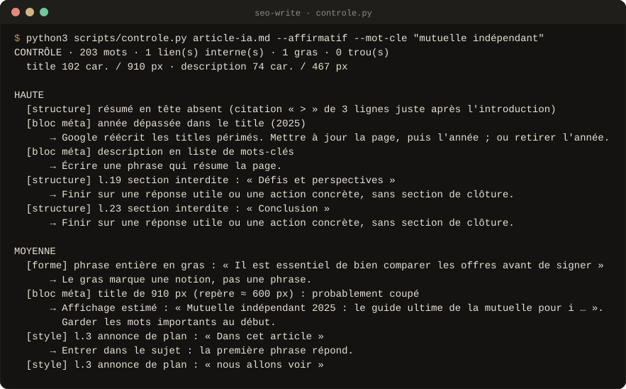
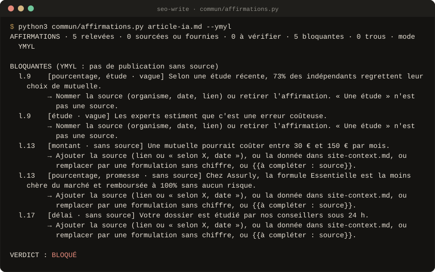
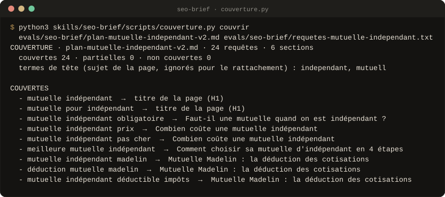
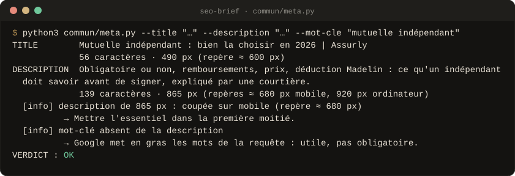
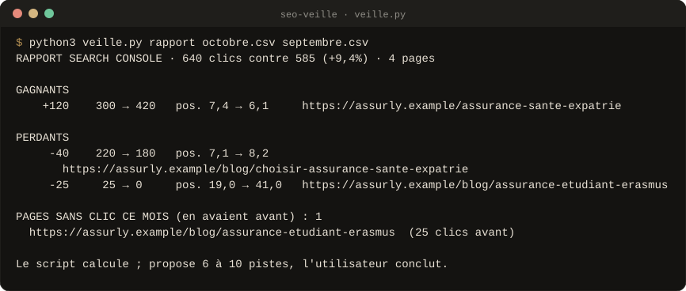

<div align="center">


<br>

**Seize Skills SEO en français pour Claude, ChatGPT, Gemini et Mistral.**<br>
Du mot-clé à l'article publiable, de l'audit au maillage interne. **Aucun chiffre inventé** : ce qui manque devient `{{à compléter}}`.

<!-- github-seulement -->
[](#versions)
[](#preuves)
[](LICENSE)
[](#les-scripts)
[](#claude-code)
[](#claudeai-et-claude-desktop)
[](#chatgpt-gemini-mistral)
[](https://github.com/Aleksander-Siebert/join-medicis-ressources)

[**Installer**](#installer) · [Les seize Skills](#les-seize-skills) · [En images](#en-images) · [Fiche Join Médicis](https://joinmedicis.com/ressources/skills/seo-skills) · [Crédits](CREDITS.md)
<!-- /github-seulement -->

<!-- Emplacement du GIF de démonstration (voir docs/media/A-FILMER.md, prise 1).
     Quand il existe, remplace l'image ci-dessous par :
      -->


<sub>Sortie réelle du contrôle de rédaction sur un article de test : chaque défaut classé par priorité, avec sa correction.</sub>

</div>

---

## Pourquoi

Les Skills SEO en circulation produisent vite des articles qui se
ressemblent : plan copié sur les concurrents, chiffres sans source, « dans
cet article, nous allons voir », conclusion de remplissage. En santé, en
assurance ou en finance, un chiffre inventé n'est pas un détail : c'est un
risque.

**Ce pack travaille comme un rédacteur SEO exigeant.** Il lit votre contexte
(`site-context.md`), la SERP et vos données, fait valider le plan avant la
moindre phrase, mesure ce qui se mesure (couverture des requêtes, largeur du
title en pixels, affirmations sans source) et ne publie jamais rien. Pas
besoin d'outil payant ; si Search Console, Semrush ou Ahrefs sont connectés à
votre IA, les Skills s'en servent.

## Les seize Skills

### Stratégie

<table>
<tr>
<td width="64" align="center"></td>
<td><b><code>/seo-plan</code></b><br>La stratégie sur 12 mois : piliers, feuille de route en 4 phases, indicateurs partant de vos vraies données.</td>
<td width="150"></td>
</tr>
<tr>
<td width="64" align="center"></td>
<td><b><code>/seo-context</code></b><br>Remplit <code>site-context.md</code> : secteur, lecteurs, pages à pousser, ton, règles maison, données produit étiquetées. Tous les autres le lisent.</td>
<td width="150"></td>
</tr>
<tr>
<td width="64" align="center"></td>
<td><b><code>/seo-keywords</code></b><br>Mots-clés et intentions, regroupés en pages (une intention, une page), cannibalisation vérifiée.</td>
<td width="150"></td>
</tr>
<tr>
<td width="64" align="center"></td>
<td><b><code>/seo-serp</code></b><br>Lit la SERP à l'envers : type de page attendu, concurrents notés sur 40, manques, gain d'information.</td>
<td width="150"></td>
</tr>
</table>

### Écrire

<table>
<tr>
<td width="64" align="center"></td>
<td><b><code>/seo-brief</code></b> <sup>v2</sup><br>Le plan validable avant toute rédaction : six questions une à une, cadre PAS, AIDA, MECE ou pyramide inversée, title et H1 à H3 commentés, couverture de 20 à 30 vraies requêtes mesurée par script, grille face aux concurrents.</td>
<td width="150"><code>couverture.py</code> <code>meta.py</code></td>
</tr>
<tr>
<td width="64" align="center"></td>
<td><b><code>/seo-write</code></b> <sup>v2</sup><br>Rédige sur le plan validé : résumé de 3 lignes en tête, réponse directe sous chaque H2, voix active, chaque affirmation chiffrée vérifiée contre ses sources, bloc méta mesuré en pixels.</td>
<td width="150"><code>controle.py</code> <code>affirmations.py</code></td>
</tr>
<tr>
<td width="64" align="center"></td>
<td><b><code>/seo-article</code></b><br>Le chemin complet, du mot-clé à l'article, avec une validation à chaque étape.</td>
<td width="150"></td>
</tr>
<tr>
<td width="64" align="center"></td>
<td><b><code>/seo-human</code></b><br>Retire les marques d'écriture IA d'un article sans casser son Markdown ni la typographie française.</td>
<td width="150"><code>humanize.py</code> <code>detect.py</code></td>
</tr>
</table>

### Contrôler

<table>
<tr>
<td width="64" align="center"></td>
<td><b><code>/seo-audit</code></b><br>Audit d'une page ou d'un site par ordre de priorité : on-page, images, Core Web Vitals, bon type de page.</td>
<td width="150"><code>onpage.py</code></td>
</tr>
<tr>
<td width="64" align="center"></td>
<td><b><code>/seo-drift</code></b><br>Photo des éléments SEO avant une mise en ligne, comparaison après : <code>noindex</code> oublié, canonical cassé, H1 supprimé.</td>
<td width="150"><code>drift.py</code></td>
</tr>
<tr>
<td width="64" align="center"></td>
<td><b><code>/seo-maillage</code></b><br>Lit le sitemap, regroupe vos pages en clusters, repère les pages orphelines et la cannibalisation, puis propose les liens.</td>
<td width="150"><code>maillage.py</code></td>
</tr>
<tr>
<td width="64" align="center"></td>
<td><b><code>/seo-veille</code></b><br>Nouvelles pages des concurrents (sitemaps) et rapport mensuel Search Console : gagnants, perdants, pages tombées à zéro clic.</td>
<td width="150"><code>veille.py</code></td>
</tr>
</table>

### Durer et étendre

<table>
<tr>
<td width="64" align="center"></td>
<td><b><code>/seo-refresh</code></b><br>Met à jour un article publié : chiffres datés, manques face à la SERP, liens, modifications à accepter une par une.</td>
<td width="150"></td>
</tr>
<tr>
<td width="64" align="center"></td>
<td><b><code>/seo-programmatic</code></b><br>Pages à grande échelle (villes, comparatifs, glossaire) sans pages satellites.</td>
<td width="150"></td>
</tr>
<tr>
<td width="64" align="center"></td>
<td><b><code>/seo-local</code></b><br>Fiche Google, avis dans le respect du droit français, pages locales, annuaires français.</td>
<td width="150"></td>
</tr>
<tr>
<td width="64" align="center"></td>
<td><b><code>/seo-social</code></b><br>SEO de YouTube, Pinterest, TikTok, LinkedIn et Google Discover.</td>
<td width="150"></td>
</tr>
</table>

<sup>v2</sup> : Skills déjà réécrits sur le nouveau socle (règles communes, preuves datées, scripts de contrôle). Les autres suivent.

## En images

Sorties réelles des scripts, sur les fichiers de test du pack. Elles sont
régénérées à chaque version (`outils/visuels/capture.py`) : si un script
change, l'image change avec lui.

<p align="center"><br>
<sub><b>/seo-write</b> · en santé, assurance ou finance, une affirmation sans source bloque la publication.</sub></p>

<p align="center"><br>
<sub><b>/seo-brief</b> · chaque vraie requête rattachée à une section du plan, avant d'écrire.</sub></p>

<details>
<summary><b>Deux autres captures</b> : le title en pixels, le rapport Search Console</summary>
<br>
<p align="center"><br>
<sub><b>/seo-brief</b> · le title et la description mesurés en pixels, pas en caractères.</sub></p>

<p align="center"><br>
<sub><b>/seo-veille</b> · le rapport mensuel à partir de deux exports Search Console.</sub></p>
</details>

<!-- Emplacement d'un GIF (voir docs/media/A-FILMER.md, prise 2) :
      -->

## Installer

### Claude Code

```
/plugin marketplace add Aleksander-Siebert/join-medicis-ressources
/plugin install seo-skills@join-medicis
```

### claude.ai et Claude Desktop

1. Réglages → Capacités : activez l'exécution de code (pour les scripts).
2. Personnaliser → Skills → importez **`seo-skills.zip`**, téléchargé depuis
   [la fiche Join Médicis](https://joinmedicis.com/ressources/skills/seo-skills).
   Le pack entier s'installe comme un seul Skill.
3. Mettez votre `site-context.md` dans les connaissances d'un Projet.

<details>
<summary>Construire le ZIP soi-même</summary>

`claude-ai/build.sh seo-skills.zip` construit le ZIP du pack. claude.ai
refuse un ZIP qui contient plusieurs `SKILL.md` ou le manifeste de plugin :
n'importez pas le dépôt tel quel.

</details>

### ChatGPT, Gemini, Mistral

Collez le `SKILL.md` voulu dans un Projet, un GPT, un Gem ou un agent. Tout
marche, sauf les scripts : les Skills font alors les mêmes contrôles à la
lecture, et le disent.

**Ensuite** : lancez `/seo-context` avec l'URL de votre site. Le pack GEO
partage le même `site-context.md`.

## Les scripts

Python 3, sans dépendance, sur votre machine :

```bash
python3 skills/seo-maillage/maillage.py --sitemap https://www.site.fr/sitemap.xml --lire --max 300
python3 skills/seo-audit/onpage.py https://www.site.fr/page/ --mot-cle "mot clé" --poids-images --cwv
python3 skills/seo-drift/drift.py photo --sitemap https://www.site.fr/sitemap.xml --max 50
python3 skills/seo-veille/veille.py rapport pages-octobre.csv pages-septembre.csv
python3 skills/seo-brief/scripts/couverture.py couvrir plan.md requetes.txt
python3 skills/seo-write/scripts/controle.py article.md --affirmatif
python3 commun/affirmations.py article.md --ymyl
python3 commun/meta.py --title "…" --description "…"
```

<details>
<summary>Comment le maillage note les liens, et la clé PageSpeed</summary>

Le maillage rapproche les pages par leur vocabulaire (TF-IDF, sans clé
d'API) et note chaque lien possible : 0,7 × proximité + 0,3 × trafic de la
page hôte. Claude relit chaque proposition, vous validez.

`--cwv` lit les Core Web Vitals avec l'API PageSpeed Insights : créez une
clé gratuite dans Google Cloud et passez-la avec `--cle` ou `PSI_API_KEY`.

</details>

## Ce qui tient le pack

<table>
<tr>
<td width="56" valign="top"></td>
<td><b>Un garde-fou et des preuves datées.</b> Le socle commun refuse le contenu copié, les fausses preuves, les liens artificiels, les pages en masse et la fausse fraîcheur ; il encadre les comparatifs nommés, les avis clients et les sujets YMYL. Ce qu'on sait de Google est classé officiel, étude, praticien ou folklore, avec sa source et sa date (<a href="commun/preuves.md"><code>commun/preuves.md</code></a>).</td>
</tr>
<tr>
<td width="56" valign="top"></td>
<td><b>La mesure séparée du jugement.</b> Les scripts mesurent la couverture, les pixels, les affirmations sans source ; Claude écrit et explique. Une donnée sans source ne sort jamais comme un fait.</td>
</tr>
<tr>
<td width="56" valign="top"></td>
<td><b>Une validation à chaque étape.</b> Le plan est validé avant la rédaction, chaque modification d'un article publié est acceptée une par une. Rien n'est publié à votre place.</td>
</tr>
</table>

## Preuves

```bash
python3 evals/tout_tester.py
```

**101 tests** : les scripts, le socle commun et l'intégrité du pack (frontmatter,
fichiers cités, socle synchronisé, typographie). Les évaluations comparatives
sont dans [`evals/RESULTATS.md`](evals/RESULTATS.md).

## Versions

| Version | Date | Ce qui change |
|---|---|---|
| 2.0 (en cours) | 12 oct. 2026 | Socle commun (règles, preuves datées, garde-fou, mesures en pixels, affirmations) ; `/seo-brief` et `/seo-write` réécrits. Les autres Skills suivent. |
| **1.1.0** | 2 oct. 2026 | Corrections d'après les guides Google, `/seo-drift`, `/seo-plan`. |
| 1.0.0 | 2 oct. 2026 | 14 Skills en français, 4 scripts, tests. |

## Crédits et licence

MIT. Le pack est né de l'analyse des Skills SEO les plus utilisés, réécrits
pour le français : la liste est dans [CREDITS.md](CREDITS.md), les mentions
de licence dans [LICENSE](LICENSE).

<div align="center">
<br>
<sub>Un pack <a href="https://joinmedicis.com">Join Médicis</a>, la bibliothèque IA gratuite des marketeurs francophones.</sub>
</div>
